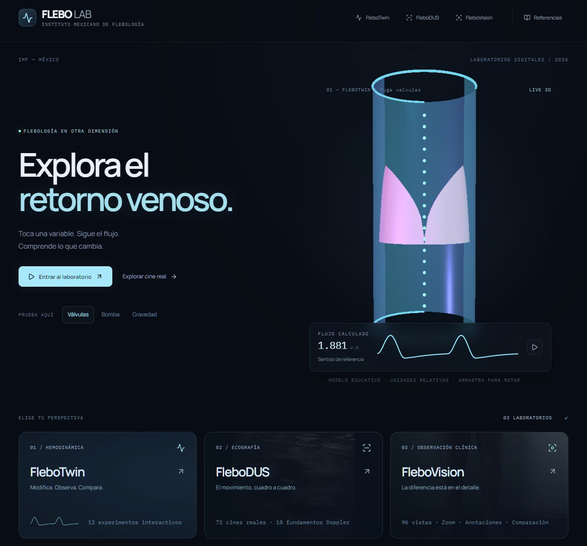

# Auditoría de interacción y publicación 0.10

6 de noviembre de 2026. Evidencia técnica del producto educativo; no aprobación médica independiente.

## Fallo corregido

La versión anterior permitía cambiar tarjetas de Twin mientras el visor permanecía en anatomía de referencia. El nuevo contrato de escenario abre la vista correspondiente, restablece tiempo y vincula escena/curvas a los parámetros elegidos. El navegador y el enlace compartido consumen un estado común.

Durante la revisión se detectó y corrigió un fallo de inicialización de los morph targets de la nueva válvula que podía dejar el canvas vacío. La inicialización de la malla se realiza antes del primer render y la revisión visual posterior confirmó válvula y red visibles. Los textos de condiciones modificadas ya no describen una colateral como activa si el usuario la desactiva.

## Pruebas terminadas

- 59/59 pruebas automatizadas; 3 archivos de pruebas. Incluyen modelo, física Doppler, trazabilidad editorial, 12 contratos de escenario, saneamiento de consultas, rutas Pages, sincronía temporal y confinamiento de las superficies valvulares.
- Comprobación íntegra del catálogo: 72 cines, 72 participantes, 12.830 cuadros, 96 fotos, 71 carpetas, 12 pares térmicos, 23 activos anatómicos/ilustrativos, 18 láminas y 6 animaciones.
- Build de producción con VITE_BASE_PATH=/flebolab/ completado. Bloques pesados de 3D y Plotly separados; no se descarga el banco completo al entrar. Queda pendiente medición de campo de rendimiento.
- 12/12 tarjetas Twin abren la vista esperada. A 1,00 s, las cuatro lecturas de cada escenario coinciden con el solver: 48/48 comparaciones. Datos brutos en qa/0.10. Esta igualdad comprueba integración numérica, no validez fisiológica.
- Twin: selección/aislamiento/corte anatómico, circuito, comparación de dos circuitos, selección B, pausa/seek, siete deslizadores y vía colateral, restauración y navegación. Red y válvula inspeccionadas visualmente tras corregir su inicialización.
- Doppler: se abrieron 10/10 apartados. Todos sus controles cambiaron gráfico o salida explicativa correspondiente. Frecuencia cambia desplazamiento ideal; el selector de territorio cambia el criterio textual, no la duración de la curva.
- Cine: cuadro siguiente, seek, velocidad 0,5×, intervalo de 0,03 a 0,43 s = 0,400 s, repetición del intervalo, play/pause, ampliación/restauración, punto y deshacer. El bloqueo mm/cm/s se mantiene. Comparación carga dos recursos y reproduce ambos.
- Vision: siete filtros de clase con conteos 21/8/33/16/8/4/6; filtro térmico; RGB 640×480 y térmica 320×240; zoom/restauración, ocultación de guía/etiquetas, favorito reversible y cuatro visores de comparación.
- Móvil a 390×844: portada, menú, Twin/ajustes, DUS biblioteca/detalle, Vision biblioteca/detalle y bibliografía; ancho de contenido 375 px más barra, sin desbordamiento horizontal global. Es emulación de navegador, no prueba física.
- La revisión conserva 19 referencias (8 flebología/UIP, 4 vasculares, 7 complementarias), bibliografía descargable y seis controversias. La base documental 0.9.1 no equivale a revisión clínica externa de la nueva interfaz.

## Publicación

**Publicación confirmada:** https://imf-hub.github.io/flebolab/ . Código fuente de la aplicación: c7cc50e; configuración de publicación: c4031d7. El workflow de Pages y la verificación finalizaron correctamente el 6 de noviembre de 2026. [Ejecución de publicación](https://github.com/imf-hub/flebolab/actions/runs/42244740312) y [verificación remota](https://github.com/imf-hub/flebolab/actions/runs/42244740282).

Se inspeccionaron en la dirección pública portada/3D, TW06 a 1,00 s, anatomía real con selección/aislamiento, TW10 tras recargar su enlace directo, video CFV-010 reproduciéndose (660×610, readyState 4) y su último cuadro 120, RGB/térmica C2/001 y enlace CEAP. Vancouver y BibTeX resuelven dentro de /flebolab/. La referencia CEAP se sitúa a 110 px bajo el encabezado. No se registraron errores de ejecución durante esta inspección pública; existe una advertencia de deprecación THREE.Clock en una dependencia.

**1.240/1.240 URLs publicadas respondieron HTTP 200**: todos los medios referenciados en los cinco catálogos, icono y dos descargas bibliográficas. Se usaron solicitudes HEAD, sin descargar los cuerpos del banco. Una solicitud separada de bytes 0–127 al MP4 devolvió HTTP 206 y coincidió con el archivo local. Datos en qa/0.10/public-assets.json, public-video-range.json y public-browser.json. El script opcional scripts/verify-public-assets.py permite repetir la comprobación contra una base HTTPS; no forma parte del build.

El enlace principal del repositorio ya apunta a GitHub Pages. El directorio canónico local es app/. No se han modificado DNS de Hostinger. Esta versión conserva noindex durante la revisión y hasta la decisión de dominio/indexación.

## Límites de la comprobación

No se ha certificado exactitud anatómica de paciente, mecánica valvular, diagnóstico desde fotografías, calibración radiométrica, distancias/velocidades DICOM ni predicción clínica. La geometría de cuatro compartimentos y sus valvas es conceptual. Faltan ensayos de dispositivos reales, proyección, lectores de pantalla, memoria prolongada y red adversa, además de revisión médica independiente y más datos calibrados. El registro de comprobaciones no afirma que se hayan probado todas las combinaciones posibles de parámetros o medios.
