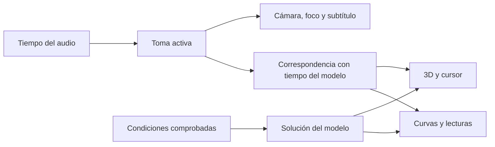

# Evaluación del método de Flebo Animaciones para FLEBOLAB

6 de noviembre de 2026. Evaluación documental y de código sobre FLEBOLAB 0.11.0, commit `95d8c38`. Estado: recomendación de integración; las funciones narradas descritas aquí no están implementadas en FLEBOLAB.

## Dictamen

**Sí conviene adoptar el método de producción y explicación guiada.** La mayor oportunidad está en FleboTwin: convertir un mecanismo que el visitante debe descubrir por sí mismo en una secuencia breve que orienta, muestra un cambio, lo relaciona con su curva y deja explorar el resultado.

Conservar React, TypeScript, Three.js r186, React Three Fiber 9, el solver existente y el alojamiento estático en GitHub Pages. Adaptar componentes concretos de la referencia a esa arquitectura. El uso de HTML/JavaScript sin React y de Three.js r128 no es la causa demostrada de su calidad visual; ambas arquitecturas permiten geometría editable, instancias y cámaras dirigidas.

No hay evidencia en esta evaluación de un aumento medido de aprendizaje, FPS o exactitud médica. Es una recomendación técnica y didáctica basada en el encaje entre las capacidades existentes y las propuestas.

## Evidencia local consultada

Proyecto de referencia: `C:/Users/USUARIO/OneDrive/Documents/ChatGPT/FLEBO ANIMACIONES`.

- `GUIA_PARA_FUTURAS_ANIMACIONES.md`: objetivo, referentes, geometría, storyboard, narración, reproducibilidad y revisión.
- `docs/animacion/ARQUITECTURA.md`: describe el inventario original; se contrastó con la ampliación posterior para evitar confundir 12 módulos iniciales con el estado documentado actual.
- `docs/animacion/PRODUCCION.md`, `CALIDAD.md`, `EXPERIENCIA_INTERACTIVA.md`, entrega de cierre y revisión médica del catálogo: contratos vigentes, separación de funciones y límites.
- `assets/app.js`: `updateTubeMesh`, construcción de superficies, `vAct`, `vTick`, `vCam3D`, `vAudioTick` y `applyCue`.
- `scripts/prepare-reviewed-narration.mjs`, compiladores y `docs/animacion/entregas/narraciones-cierre.json`: SSML, voz, marcas, duración y hash de audio.
- `examples/animacion/muestreo-tiempo.mjs`: ejemplo de muestreo absoluto y partículas con semilla; es una ayuda para desarrollos futuros, no un exportador terminado.

En FLEBOLAB se contrastaron `VenousScene.tsx`, `valveVisual.ts`, `transport.ts`, `useSimulation.ts`, `Twin.tsx`, `ReferenceAnatomy.tsx`, `Cine.tsx`, `CEAPExplorer.tsx` y las versiones de `package.json`/lock.

Se conservaron los archivos del proyecto de referencia. No se generó voz ni se modificó la aplicación pública durante esta evaluación.

## Qué adoptar, adaptar o reservar

| Propuesta | Situación de FLEBOLAB | Decisión |
|---|---|---|
| Objetivo y storyboard antes del modelado | Los perfiles describen mecanismos y consecuencias; falta una secuencia narrada que los conduzca. | Adoptar como requisito de cada explicación. Un objetivo y un foco por toma. |
| BufferGeometry y deformación editable | Las valvas ya tienen superficies semilunares, morph targets de posición/normales e inserción definida por código. | Conservar y refinar. No reemplazar automáticamente morphs por recálculo de vértices en CPU. |
| Curvas, tubos, grupos e instancias | La red ya usa CatmullRomCurve3, TubeGeometry, grupos e InstancedMesh. Los trazadores dependen del flujo integrado del solver. | Mantener el transporte calculado. Mejorar lectura de pared, seno, valvas y capas cuando ayude al objetivo y se verifique la anatomía. |
| Separación de capas y aislamiento | La anatomía de referencia ya permite capas, corte y aislamiento; el esquema funcional es distinto del GLB. | Añadir revelado guiado sin deformar el GLB anatómico como si estuviera calibrado al modelo 0D. |
| Cámara, foco y pausas | Hay encuadre adaptable, giro libre y cámara A/B compartida; falta dirección editorial por toma. | Añadir cámara guiada opcional, con un dueño por propiedad y salida clara a exploración libre. |
| Voz Rocío, español, SSML y 1× | FLEBOLAB no tiene narración integrada. La referencia conserva solicitudes y procedencia. | Adecuado para un piloto; conservar configuración y verificar resultado real del proveedor. |
| audio.currentTime y marcas absolutas | El modelo tiene un reloj propio compartido por escena, partículas y lecturas. | Usar el audio como reloj editorial y mapearlo explícitamente al tiempo del modelo. |
| sample(t, parámetros, semilla) | Solver y transporte ya son deterministas para las mismas condiciones; algunas transiciones visuales usan amortiguación incremental. | Completar esa separación para guías con saltos y para una futura exportación. No declarar reproducibilidad de toda la cámara actual. |
| Exportación MP4 | No es necesaria para el laboratorio web ni existe como exportador de la referencia. | Fase posterior, con composición y comprobación propias si se solicita. |
| Copiar el runtime r128 o insertar otro visor completo | FLEBOLAB ya dispone de su escena, ciclo de render, solver y rutas. | Adaptar los métodos al runtime actual y reutilizar la escena existente. Evitar dos motores o una interfaz paralela. |

La documentación oficial de [React Three Fiber sobre rendimiento](https://r3f.docs.pmnd.rs/advanced/pitfalls) respalda reutilizar geometrías/materiales, instanciar y actualizar objetos en el ciclo de escena. El manual de [Three.js sobre actualización de geometría](https://threejs.org/manual/pages/how-to-update-things.html) distingue actualizar buffers existentes de crear nuevos recursos. Estas técnicas son compatibles con la arquitectura actual; no prueban por sí solas una mejora de rendimiento.

## Cuatro adaptaciones necesarias

### 1. Mantener coherencia entre voz, mecanismo y gráfica

El tiempo narrativo y el tiempo del modelo tienen funciones diferentes. La explicación puede detener el mecanismo para describir una valva mientras continúa la voz. La sangre, la apertura y el cursor deben seguir consultando la misma solución en ese instante del modelo.

Cada toma declara su intervalo narrativo, condiciones, tiempo inicial/final del modelo, vista, cámara, foco, subtítulo y referencias. Una pausa editorial puede mantener fijo el tiempo del modelo. Un salto reconstruye la toma completa; no depende de haber reproducido las anteriores.

`audio.currentTime` sirve para ubicar el relato, pero su lectura es una aproximación de la posición de reproducción. Además, el evento `timeupdate` tiene frecuencia variable. Consultar la posición desde el ciclo de render y atender reproducción, pausa, búsqueda, espera y finalización; no prometer sincronía exacta por fotograma usando solo ese evento. Fuentes: [MDN currentTime](https://developer.mozilla.org/en-US/docs/Web/API/HTMLMediaElement/currentTime) y [MDN timeupdate](https://developer.mozilla.org/en-US/docs/Web/API/HTMLMediaElement/timeupdate_event).

### 2. Usar estados calculados, con acciones por ID

En la referencia, `vAct` localiza controles mediante su texto visible y algunas acciones animan su valor repetidamente. En FLEBOLAB, `useSolution` difiere el cálculo 70 ms y cancela la petición pendiente cuando llegan condiciones nuevas. Animar deslizadores cada fotograma podría posponer continuamente el cálculo o mostrar transiciones que no correspondan a una solución disponible.

Para el primer piloto, preparar soluciones completas de los perfiles de la lección y cambiar entre ellas en pasos explícitos. Mantener fijas las condiciones durante cada ciclo. Si se necesita una evolución continua de parámetros, definir primero la entrada temporal y resolverla de forma consistente; no interpolar curvas estacionarias como si fueran una nueva simulación validada.

Usar acciones tipadas e IDs estables como `scenarioId`, `view` y `focusId`; no buscar un botón por su rótulo ni disparar eventos DOM para controlar el modelo. El texto podrá cambiar sin romper el guion.

### 3. Separar Guía y Explorar en la misma mesa

Mantener la distribución blanca/roja IMF y el 3D, gráficas y ajustes juntos. Añadir dos actividades claras:

- **Explorar:** conserva controles libres, ritmo, comparación y cámara manual actuales.
- **Explicación guiada:** el usuario inicia la voz y la secuencia; puede pausar, repetir una toma, activar subtítulos o regresar a explorar.

Al manipular condiciones durante una explicación, detener la guía o pasar explícitamente a Explorar para evitar que la voz siga describiendo otro estado. La cámara automática se suspende al tomar el usuario el control y se recupera mediante una acción visible. Definir restauración de la configuración anterior al salir.

En movimiento reducido, mantener la información con cambios de foco/encuadre discretos. La explicación debe poder seguirse sin sonido, por subtítulos y pasos. La voz no se reproduce automáticamente al abrir la página y la franja de subtítulos no tapa la curva ni las valvas.

### 4. Adaptar la narración al público médico de FLEBOLAB

El catálogo de referencia tiene perfiles paciente/médico, pero sus documentos distinguen ese texto de una segunda pista médica grabada. Reutilizar el proceso de producción, revisando el guion para este producto y el mecanismo real de cada laboratorio.

La voz no convierte un esquema en evidencia clínica. Cada toma nueva debe relacionar afirmación, estructura/flecha y fuente. Conservar prioridad UIP/flebología, después sociedades vasculares y después fuentes complementarias. Los tiempos, calibres y flujos relativos del modelo no se describen como valores de pacientes.

## Voz: comprobación realizada

El conector HeyGen devolvió para `84854979e66846989bc6c5855f53268f`:

- Nombre: **Rocío - Calm & Trustworthy**.
- Idioma: Spanish; estado: complete; admite pausas.

La referencia registra `language: es`, `inputType: ssml`, `<speak>`, pausas `<break time="0.9s"/>`, omisión de `engine` y `speed`, respuesta `orca`, reproducción 1× y ausencia de aceleración local. El esquema actual de `create_speech` admite SSML y pausas en segundos; permite conservar los valores guardados al omitir esos parámetros.

La consulta de voz confirma su disponibilidad en ese momento. No confirma por sí sola el motor que devolverá una generación nueva, la compatibilidad definitiva de todos los ajustes ni la calidad de un guion todavía no producido. Registrar lo solicitado y devuelto; no deducir una identidad de motor distinta del contrato real.

Producción propuesta: revisar el guion y los nombres médicos, generar una toma continua dentro del límite del servicio, conservar solicitud/audio/tiempos/duración/voz/motor reales, verificar pronunciación y alinear después las acciones. Mantener audio a 1×. Las pausas de 0,9 s son un punto de partida; el tiempo de observación debe adecuarse a cada plano y al audio final.

Guardar MP3 y subtítulos con versión por hash y carga bajo demanda. GitHub Pages puede distribuir esos archivos estáticos; la generación se realiza fuera del navegador y no se exponen claves del proveedor. Las marcas de palabras, cuando existan, se conservan y contrastan; si no son fiables, usar subtítulos por frase con tiempos revisados.

## Aplicación por laboratorio

| Laboratorio | Beneficio previsto | Primera aplicación aconsejada |
|---|---|---|
| FleboTwin | Alto encaje: voz/cámara pueden relacionar cambios espaciales con el resultado numérico. | Válvula competente frente a fuga del modelo; después bomba muscular y conexiones. Mantener curva sincronizada y breve pausa de observación. |
| FleboDUS | Buen encaje como acompañamiento al material real y a los esquemas Doppler. | Guiar una maniobra o un principio, señalando el cuadro/intervalo pertinente. Conservar los cuadros y tiempos de adquisición y diferenciar el esquema del cine real. |
| FleboVision | Útil para explicar la tarea y la clasificación; menor necesidad de nueva geometría 3D. | Guía breve CEAP 2020 que conduzca a observar, describir y comprobar. Conservar fotos originales y evitar etiquetas clínicas no documentadas. |

No añadir una narración por cada fotografía o cine sin un objetivo distinto; agrupar por concepto reduce repetición y recursos que descargar.

## Piloto recomendado antes de ampliar todo el catálogo

Una pieza guiada de **60–90 segundos como objetivo editorial**, cuya duración final se ajusta al audio real. Tema: **qué cambia entre competencia y fuga en el modelo valvular**. El guion final aún no está redactado ni aprobado.

| Toma | Qué debe comprenderse | Cambio visible y comprobación |
|---|---|---|
| Orientación | Dónde están pared, valvas y sentido de referencia. | Conjunto y foco local con cámara estable; curva ya visible. |
| Eyección | Cómo se relaciona el estado de apertura con el flujo calculado. | Ir a la contracción del perfil competente y ubicar el cursor correspondiente. |
| Coaptación | Qué representa el bloqueo ideal de flujo inverso de esta rama. | Pausa en el estado pertinente y observación del borde libre, sin atribuir biomecánica validada. |
| Comparación | Qué cambia al introducir fuga en las condiciones del modelo. | A/B y flujo inverso calculado; conservar iguales referencias y tiempo del modelo. |
| Recuperación de contexto | Cómo seguir experimentando. | Restituir vista general y pasar a Explorar, con una pregunta breve. |

Antes de generar la pista final, probar la toma anatómica más difícil y verificar que la explicación se puede demostrar con el estado disponible. Después de aceptar la narración, alinear los tiempos finales de cámara, acciones y subtítulos.

## Comprobación para aceptar una futura implementación

1. La misma toma/tiempo produce el mismo estado tras reproducir seguido, saltar o volver atrás. Escena y gráfica coinciden con la solución prevista.
2. Pausar, esperar carga o ocultar la pestaña no deja otra capa temporal avanzando de forma accidental. Se puede reabrir la pieza sin conservar una pista antigua.
3. Giro, zoom, selección y salida a explorar no compiten con una cámara automática ni dejan la narración describiendo condiciones distintas.
4. No se reconstruyen geometrías innecesariamente por fotograma; se liberan listeners, audio, materiales y observadores. Medir rendimiento en equipo y tamaño documentados antes de afirmar una mejora.
5. Revisar voz completa a velocidad normal, pronunciación, texto, subtítulos y uniones; no basta comprobar la transcripción del proveedor.
6. Conservar 3D, gráficas y ajustes utilizables en escritorio; revisar 390 × 844, teclado, subtítulos y movimiento reducido. Diferenciar navegador con tamaño móvil de teléfono físico.
7. Revisión de afirmaciones y elementos visuales con sus fuentes; revisión médica independiente sigue siendo un requisito separado.
8. Si se encarga MP4: composición propia, tiempo `fotograma/fps`, semilla/checkpoints cuando corresponda, archivo exportado y metadatos comprobados. Es un entregable adicional.

## Alcance de esta evaluación

Se revisaron documentos, código, procedencia de narraciones, compatibilidad técnica y catálogo de voz. No se escucharon nuevamente las 22 piezas completas, no se midieron FPS ni se realizó un ensayo de comprensión con médicos. No se instaló otro motor, no se produjeron audios y no se cambió la web. El siguiente trabajo propuesto es el piloto narrado sobre la escena existente, con revisión antes de extenderlo al catálogo.
