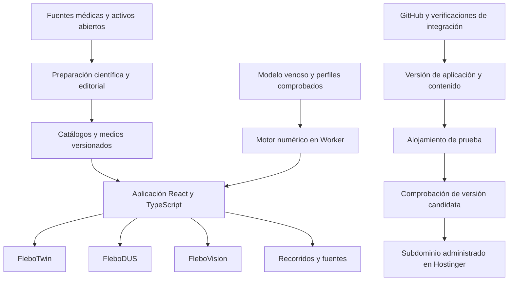

# Plan maestro de FLEBO LAB para lanzamiento público

**Instituto Mexicano de Flebología · Versión 3.0 · 6 de noviembre de 2026**

**Productos:** FleboTwin, FleboDUS y FleboVision.  
**Público:** médicos, docentes y comunidad profesional de flebología.  
**Entrega de esta etapa:** una plataforma pública robusta, visualmente sobresaliente, útil para explorar y para presentar en clase.  
**Repositorio:** GitHub, mediante la cuenta conectada del proyecto.  
**Dominio:** subdominio del dominio de Fernando administrado en Hostinger; la conexión DNS se hará después de construir y verificar la plataforma.  
**Prioridad de recursos:** datos públicos, herramientas abiertas, contenido propio y activos institucionales reutilizables. Las compras se reservan para mejoras posteriores.

Este es el **plan rector de construcción**. Sustituye el alcance reducido de la propuesta anterior: las comprobaciones pequeñas son trabajo interno de implementación y no constituyen el producto que se entregará a los médicos. El lanzamiento debe presentar los tres laboratorios completos dentro del alcance definido aquí, con suficiente contenido para una exploración extensa y con recorridos que demuestren su valor desde la primera visita.

Las cantidades de contenido y las prestaciones siguientes son **objetivos de producción y aceptación**, no afirmaciones de que la plataforma o sus colecciones ya estén implementadas. Los conteos comprobados de las fuentes se distinguen de esas metas.

## Índice

1. [Visión y decisiones del proyecto](#1-visión-y-decisiones-del-proyecto)
2. [Contrato de la primera versión pública](#2-contrato-de-la-primera-versión-pública)
3. [Experiencia y estructura de navegación](#3-experiencia-y-estructura-de-navegación)
4. [Dirección visual y sistema de interacción](#4-dirección-visual-y-sistema-de-interacción)
5. [FleboTwin completo para lanzamiento](#5-flebotwin-completo-para-lanzamiento)
6. [FleboDUS completo para lanzamiento](#6-flebodus-completo-para-lanzamiento)
7. [FleboVision completo para lanzamiento](#7-flebovision-completo-para-lanzamiento)
8. [Recorridos y conexiones entre laboratorios](#8-recorridos-y-conexiones-entre-laboratorios)
9. [Arquitectura de aplicación](#9-arquitectura-de-aplicación)
10. [Modelo científico de FleboTwin](#10-modelo-científico-de-flebotwin)
11. [Contenido y contratos de datos](#11-contenido-y-contratos-de-datos)
12. [Fuentes médicas y medios de producción](#12-fuentes-médicas-y-medios-de-producción)
13. [Bibliotecas seleccionadas](#13-bibliotecas-seleccionadas)
14. [Skills y guías de trabajo](#14-skills-y-guías-de-trabajo)
15. [Producción de medios y preparación de activos](#15-producción-de-medios-y-preparación-de-activos)
16. [Estructura completa del repositorio](#16-estructura-completa-del-repositorio)
17. [GitHub y flujo de integración](#17-github-y-flujo-de-integración)
18. [Alojamiento y subdominio de Hostinger](#18-alojamiento-y-subdominio-de-hostinger)
19. [Rendimiento y accesibilidad](#19-rendimiento-y-accesibilidad)
20. [Calidad médica y verificación](#20-calidad-médica-y-verificación)
21. [Fases de construcción y entregables](#21-fases-de-construcción-y-entregables)
22. [Backlog de ejecución](#22-backlog-de-ejecución)
23. [Salida pública y mantenimiento](#23-salida-pública-y-mantenimiento)
24. [Ampliaciones posteriores](#24-ampliaciones-posteriores)
25. [Criterio final de terminado](#25-criterio-final-de-terminado)

## 1. Visión y decisiones del proyecto

FLEBO LAB será un laboratorio médico digital en español donde el médico pueda **ver un mecanismo, modificar una condición, observar su efecto y relacionarlo con imágenes reales**. Combina una experiencia de exploración independiente con herramientas para que un profesor prepare una demostración rigurosa y visualmente memorable.

El producto integra tres experiencias con personalidad propia:

| Laboratorio | Pregunta que responde | Valor principal |
|---|---|---|
| FleboTwin | ¿Cómo cambian presión, volumen, flujo y válvulas al modificar las condiciones venosas? | Exploración de mecanismos mediante anatomía, animación y curvas coordinadas |
| FleboDUS | ¿Qué se observa durante una adquisición ecográfica y cómo se interpreta su contexto? | Cine real, maniobras, orientación, comparación y fundamentos del Doppler |
| FleboVision | ¿Qué hallazgos son visibles y cómo describirlos y compararlos? | Biblioteca visual, ampliación, anotaciones y contexto clínico documentado |

### 1.1 Decisiones firmes

- El objetivo es un lanzamiento público robusto dirigido a médicos.
- Se construyen los tres laboratorios antes de conectar el subdominio definitivo.
- GitHub es el centro de código, versiones y verificación de cambios.
- El dominio continúa bajo administración de Fernando en Hostinger.
- Los recursos abiertos tienen prioridad. No se requieren compras para comenzar ni para completar el alcance público inicial.
- FLEBO LAB conserva su independencia del Atlas Anatómico Flebológico. No se modifica ese producto para cumplir este plan.
- FleboPatient permanece eliminado. No se incorpora un chatbot de pacientes ni un cuarto laboratorio.
- La experiencia pública inicial se puede usar sin una cuenta obligatoria. No se ha definido un modelo comercial ni una suscripción.
- El contenido médico se presenta en español, con términos y equivalencias internacionales cuando ayuden a reconocer fuentes o equipos.

### 1.2 Qué significa una versión robusta

Una versión robusta tiene profundidad de contenido, funciones terminadas, navegación coherente, buena respuesta, estados de error cuidados y fuentes identificables. El visitante debe poder explorar durante una sesión extensa, volver a un escenario, comparar material y compartir una vista concreta.

El atractivo visual se construye con anatomía bien preparada, movimientos comprensibles, una composición consistente y medios clínicos que se puedan observar con detalle. Las partes ilustrativas, experimentales y clínicas se identifican de manera breve y natural.

La marca FleboTwin se conserva como nombre de producto. Su primera versión modela una pierna genérica para enseñanza; no requiere identificar un paciente ni producir una predicción individual.

## 2. Contrato de la primera versión pública

### 2.1 Metas de producción

| Componente | Meta de la versión pública | Umbral de aceptación inicial |
|---|---|---|
| FleboTwin | 12 escenarios editados, agrupados en 6 familias fisiológicas; 3 vistas coordinadas: territorio, válvula y circuito | Los 12 escenarios abren, se pueden explorar y tienen explicación, controles pertinentes y representación científica identificada |
| Biblioteca FleboDUS | Objetivo de 72 clips clínicos seleccionados de compresión y orientación | Al menos 48 clips revisados, los cuatro sitios de ThrombUS+ representados y al menos 24 identificadores de participantes distintos |
| Flujo femoral experimental | 4 extractos preparados de Waterloo, con su contexto y procesamiento | Al menos 2 extractos utilizables; una pieza puede contener varios momentos del mismo participante sin contarlos como casos independientes |
| Fundamentos Doppler | 10 demostraciones interactivas y 8 láminas de lectura y maniobras | Todas operativas, con escalas y naturaleza ilustrativa claramente indicadas |
| Biblioteca FleboVision | Objetivo de 96 fotografías RGB y vistas clínicas seleccionadas | Al menos 60 vistas revisadas de 35 carpetas de casos de origen distintas, con representación C0-C6 según las etiquetas y contexto disponibles |
| Comparación RGB y térmica | 12 parejas seleccionadas, conservando relación de caso y vista | Al menos 8 parejas verificadas; térmica y RGB no se cuentan como pacientes diferentes |
| Recorridos editoriales | 12 recorridos temáticos de 5-10 minutos | Cada recorrido conecta recursos existentes y permite entrar o salir libremente |
| Material explicativo | 18 láminas propias y 6 animaciones breves de apoyo | Adaptaciones atribuibles o contenido propio, legible y vinculado a una función de los laboratorios |
| Documentación pública | Guía de uso, alcance del modelo, fuentes, créditos y novedades | Navegable, específica y consistente con la versión publicada |

Las metas no se alcanzarán duplicando archivos, contando frames como estudios o atribuyendo una nueva etiología a material de otro dominio. En cada colección se publicará el conteo que se haya producido realmente. Una diferencia entre objetivo y conteo final se resolverá editorialmente antes de la salida; no se anunciará contenido inexistente.

Las clases C4-C6 tienen menos casos disponibles en TRICVI-C. Se pueden mostrar varias vistas útiles de un caso, conservando su vínculo, y complementar con archivos individuales correctamente documentados. La selección no debe fingir una representación equilibrada de todas las subclases, recurrencias o fototipos.

### 2.2 Funciones transversales obligatorias

1. Buscador y filtros útiles por laboratorio, tema, territorio y tipo de material.
2. Comparación simultánea A/B, con controles comunes cuando corresponda.
3. Vista de presentación y pantalla completa.
4. Enlaces que restauran un caso o escenario concreto de una versión identificada.
5. Anotaciones docentes reversibles, separadas del original.
6. Fuentes y créditos accesibles desde cada recurso.
7. Favoritos y ajustes guardados en el dispositivo, sin exigir registro.
8. Recorridos que funcionan sin un tutor automático.
9. Navegación por teclado, táctil y ratón.
10. Exportación de gráficas propias y fichas de vista, según los derechos del contenido incluido.

### 2.3 Entrega pública sin pantallas vacías

No habrá secciones principales anunciadas con «próximamente» para compensar funciones pendientes. La salida incluye biblioteca real de compresión, demostraciones Doppler completas, galería clínica, simulador de mecanismos y recorridos. El reflujo clínico real se incorporará cuando cada recurso tenga espectro, contexto y permiso suficientes; las demostraciones educativas de esa sección estarán terminadas desde el lanzamiento.

La exploración libre de sonda que genera cualquier corte nuevo, la personalización individual y la simulación fluido-estructura completa son ampliaciones distintas. Su ausencia no impide una experiencia profesional y extensa con las capacidades anteriores.

## 3. Experiencia y estructura de navegación

### 3.1 Primera visita

La portada presenta una vista visual de cada laboratorio, una demostración representativa y dos entradas claras: **Explorar** y **Recorridos**. El usuario puede llegar a un caso sin recorrer formularios ni configuraciones técnicas.

Un recorrido destacado de aproximadamente seis minutos enlaza una válvula, una secuencia de compresión y una comparación de signos cutáneos. Debe mostrar inmediatamente qué hace diferente a cada laboratorio y cómo se relacionan.

### 3.2 Estructura de rutas

```text
/
├── /laboratorios
├── /flebotwin
│   ├── /escenarios
│   ├── /escenario/:scenarioId
│   ├── /comparar
│   └── /modelo
├── /flebodus
│   ├── /biblioteca
│   ├── /caso/:caseId
│   ├── /comparar
│   ├── /doppler
│   └── /maniobras
├── /flebovision
│   ├── /biblioteca
│   ├── /caso/:caseId
│   ├── /comparar
│   └── /signos
├── /recorridos
│   └── /:pathwayId
├── /guia
├── /fuentes
├── /creditos
└── /novedades
```

La implementación puede prerenderizar portada, páginas informativas y fichas editoriales. Los laboratorios se cargan como aplicaciones interactivas dentro de esas rutas. Las entradas directas deben funcionar también después de recargar la página.

### 3.3 Espacio de trabajo de los laboratorios

| Zona | Función |
|---|---|
| Cabecera breve | Nombre del laboratorio, título del caso y navegación |
| Explorador lateral | Escenarios, casos, filtros y recorrido activo |
| Centro | Escena, cine o fotografía; máxima prioridad visual |
| Panel contextual | Controles y explicación del elemento seleccionado |
| Franja temporal | Reproducción, fase, cursor y gráficas cuando corresponda |
| Barra de herramientas | Comparar, anotar, presentar, compartir y consultar fuente |

Los paneles se pueden plegar para dejar una imagen limpia en proyección. En móvil se convierten en paneles superpuestos y pestañas, conservando una zona central usable.

### 3.4 Estados que deben diseñarse

Cada pantalla tendrá estados de carga con progreso cuando sea medible, recurso disponible, comparación activa, ausencia de resultados, error recuperable, recurso sin escala, modo de presentación y capacidad gráfica limitada. La explicación de un fallo debe permitir reintentar o continuar con otro material, sin mostrar trazas de programación.

## 4. Dirección visual y sistema de interacción

### 4.1 Identidad

- Identidad académica del IMF: rojo institucional, blancos y grises claros; áreas oscuras reservadas para observación y escenas cuando mejoren el contraste.
- Tipografía sobria, jerarquía clara y abundante espacio para el medio principal.
- Etiquetas anatómicas legibles con líneas guía y control de visibilidad.
- Botones y deslizadores con nombres clínicamente comprensibles.
- Señales de estado consistentes: selección, reproducción, pausa, comparación y anotación.
- Uso de logotipos originales del IMF cuando se incorporen al repositorio de activos; no recrearlos con generación de imágenes.

### 4.2 Recursos de impacto visual incluidos

| Recurso | Resultado buscado | Regla de ejecución |
|---|---|---|
| Transparencia de capas | Entender profundidad y relación superficial/profunda | Deslizadores por capa; evitar que la transparencia haga desaparecer vasos relevantes |
| Corte desplazable | Relacionar el territorio con una sección | Superficie de corte y leyenda acordes al tipo de geometría; no llamarla una imagen diagnóstica |
| Válvula ampliada | Observar apertura, cierre y fuga representada | Movimiento vinculado al estado del modelo o identificado como explicación ilustrativa |
| Trazadores de flujo | Seguir dirección y fase | Muestreo de los datos del modelo; velocidad de animación con escala visual documentada |
| Contorno de selección | Localizar un vaso sin perder el territorio | Efecto discreto que no altera el significado del flujo |
| Comparación coordinada | Ver la diferencia al cambiar una condición | Mismo punto de observación y convenciones comunes |
| Cursor en curvas y escena | Relacionar una fase con sus variables | Un único reloj de simulación y marcadores consistentes |
| Movimiento de interfaz | Mantener continuidad al abrir, comparar y enfocar | Transiciones breves y respeto a reducción de movimiento |

Los efectos de luz, sombreado y color pertenecen a las escenas explicativas. Las fotografías y ecografías mantienen una representación fiel al original; las marcas se superponen en una capa independiente.

### 4.3 Entregables de diseño

1. Mapa de pantallas y navegación.
2. Diseño de portada y de los tres espacios de trabajo, en escritorio y móvil.
3. Componentes comunes, colores, tipografía, iconos y estados.
4. Diseño de escena base, válvula y curvas de FleboTwin.
5. Diseño de comparación de cines y de fotografías.
6. Revisión de lectura en proyección y contraste sobre las imágenes reales elegidas.

Estos diseños se implementan dentro del mismo proyecto. La exploración visual no abre una segunda plataforma ni modifica el atlas.

## 5. FleboTwin completo para lanzamiento

### 5.1 Tres vistas coordinadas

**Vista territorial:** pierna de referencia con capas de piel, planos musculares y estructuras de apoyo disponibles, red venosa superficial/profunda y perforantes representadas. Permite seleccionar, aislar, enfocar, ocultar y consultar estructuras.

**Vista valvular:** ampliación de un segmento con pared y valvas, dirección del flujo, estado de competencia y fase de bomba. Se puede abrir desde la estructura seleccionada conservando el contexto del territorio.

**Vista de circuito:** red simplificada de compartimentos y conexiones que muestra qué elementos participan en el cálculo. Es útil para comprender los supuestos, comparar segmentos y relacionar presión con flujo.

Las tres vistas comparten selección y tiempo. La visualización territorial puede ser una anatomía de referencia y el circuito una simplificación; la interfaz explica esa relación sin afirmar una correspondencia geométrica de paciente.

### 5.2 Anatomía y geometría

El inventario de producción identificará vena femoral común, femoral, femoral profunda, poplítea, territorios tibiales y fibulares (peroneos) representados, safena magna, safena menor, uniones y conexiones perforantes pertinentes. El nivel exacto de detalle dependerá de los activos revisados y de la red del modelo.

Las estructuras clínicas se nombran y relacionan con fuentes. BodyParts3D y HRA proporcionan material de referencia; la red funcional y las válvulas pueden requerir geometría propia. Cuando una geometría sea esquemática o paramétrica se indicará en la ficha de la vista. No se inventarán perforantes específicas para llenar un catálogo.

### 5.3 Familias y doce escenarios

| ID | Familia | Escenario | Interacción y observación |
|---|---|---|---|
| TW01 | Referencia y postura | Retorno venoso en decúbito | Explorar potenciales, volumen y dirección con parámetros de referencia |
| TW02 | Referencia y postura | Cambio de postura | Comparar alturas y presión; visualizar la referencia hidrostática |
| TW03 | Bomba muscular | Ciclo de contracción y relajación | Reproducir por fases y observar salida, vaciamiento y llenado |
| TW04 | Bomba muscular | Actividad muscular reducida frente a conservada | Comparar perfiles de activación con las demás condiciones fijas |
| TW05 | Competencia valvular | Segmento competente | Relacionar gradiente, estado valvular y dirección |
| TW06 | Competencia valvular | Fuga valvular | Modificar conductancia inversa y observar su efecto dentro del modelo |
| TW07 | Comunicación venosa | Comunicación superficial y profunda | Seleccionar conexiones y seguir sus series temporales |
| TW08 | Comunicación venosa | Cambio de una conexión perforante | Comparar una condición de referencia y otra modificada, con supuestos visibles |
| TW09 | Resistencia de salida | Aumento de resistencia proximal | Comparar acumulación y salida sin convertirlo en diagnóstico de una lesión concreta |
| TW10 | Resistencia de salida | Salida alternativa representada | Explorar una conexión colateral explícita en la red; identificarla como configuración genérica |
| TW11 | Presión exterior | Cambio de presión extravascular | Relacionar presión transmural y volumen con una ley de pared documentada |
| TW12 | Presión exterior | Combinación de bomba, válvula y presión exterior | Comparación integrada, conservando límites del modelo y sin recomendaciones terapéuticas |

Los escenarios son configuraciones editadas de fenómenos y comparaciones, no doce modelos clínicos independientes. Cada uno especificará si muestra resultados cuantitativos con parámetros de referencia, relaciones normalizadas o una explicación esquemática. Los fenómenos prioritarios se construirán y comprobarán; las condiciones que el modelo no reproduzca no se resolverán mediante curvas inventadas.

### 5.4 Funciones obligatorias

- Activar y regular transparencia por capa.
- Seleccionar una estructura desde la escena o desde la lista.
- Aislar una estructura y volver al territorio.
- Cámaras anterior, posterior, medial y oblicua, con retorno a vista inicial.
- Corte o sección cuando la geometría lo permita, con identificación del tipo de representación.
- Reproducción, pausa, avance por fase, reinicio y velocidad de reproducción.
- Controles de postura, estado valvular, actividad de bomba y parámetros autorizados para cada escenario.
- Curvas de presión, flujo y volumen con unidades o normalización declaradas.
- Comparación de dos configuraciones con cámaras y tiempo coordinados.
- Marcadores de contracción, relajación y cambio de condición.
- Exportación de las series del modelo en CSV y de gráficas con fuente y versión.
- Enlace compartible que conserve escenario, parámetros permitidos y versión del modelo.

### 5.5 Reglas de sincronización

La integración numérica produce una serie identificada. Escena, curvas, válvula y trazadores leen esa misma serie y reloj. Una bajada de cuadros por segundo no cambia el paso del solver ni la presión calculada. Los cambios de parámetros generan o seleccionan una nueva solución, con transición visual separada del cálculo.

Para comparar, se sincroniza la fase relativa del ciclo. No se superponen series con duraciones o referencias de presión incompatibles sin informar la diferencia.

## 6. FleboDUS completo para lanzamiento

### 6.1 Biblioteca real con profundidad

La colección inicial de compresión se construirá con el conjunto de entrenamiento ThrombUS+. Sus cuatro sitios permiten organizar una navegación por territorio y una selección contrastante por compresibilidad, lado y características del cine. La biblioteca mostrará miniatura, contexto disponible, duración y fuente.

| Código del origen | Sitio documentado | Tratamiento en la biblioteca |
|---|---|---|
| CFV | Vena femoral común en región inguinal | Identificar relaciones vasculares y compresión en ese sitio |
| GS | Sitio donde se visualiza la safena magna uniéndose a la femoral común | Conservar el contexto de unión; no presentarlo como una exploración completa de la safena |
| FV | Vena femoral en el muslo | Comparar orientación y maniobra del cine seleccionado |
| PV | Vena poplítea en región de la rodilla | Conservar segmento, lado y contexto de adquisición |

El muestreo docente buscará variedad de participantes, equipos o calidades documentadas y momentos representativos. Las etiquetas positivas y negativas se equilibrarán para la enseñanza cuando sea posible, explicando que esa selección no representa prevalencia poblacional. Los clips de compresibilidad parcial se incluirán conforme estén disponibles y revisados.

### 6.2 Herramientas del visor

| Función | Comportamiento de lanzamiento |
|---|---|
| Cine | Reproducción continua, pausa, avance y retroceso de un cuadro, repetición de intervalo |
| Velocidad | Control de reproducción conservando una referencia al tiempo original |
| Navegación | Miniaturas, marcador temporal y salto a momentos editoriales |
| Imagen | Zoom, desplazamiento y restauración; aspecto y orientación preservados |
| Comparación | Dos casos o dos momentos, controles independientes o reproducción coordinada |
| Anotación | Flechas, puntos, líneas y rótulos reversibles |
| Anatomía | Mapa del segmento y contexto de vista, separado de la imagen adquirida |
| Mediciones | Distancia, tiempo o velocidad solo con calibración aplicable y comprobada |
| Contexto | Segmento, lado, postura, maniobra, equipo y datos de adquisición cuando consten |
| Procedencia | Fuente, versión, naturaleza del recurso y explicación editorial |

Cornerstone3D será el candidato principal para las funciones DICOM. Se admitirán derivados preparados de forma controlada cuando sean necesarios para la reproducción web; cada derivado conserva referencia al original y las transformaciones realizadas.

Un reproductor de video no garantiza acceso exacto a todos los frames. Para el avance por cuadros que requiera precisión se usará el DICOM o una representación con índice de cuadros y tiempos comprobados. Se podrá ofrecer una reproducción ligera de video y cargar el modo de inspección precisa al solicitarlo.

### 6.3 Diez demostraciones de fundamentos Doppler

| ID | Demostración | Función de aprendizaje |
|---|---|---|
| DP01 | Dirección del haz y del flujo | Relacionar orientación con signo y leyenda |
| DP02 | Inversión del mapa de color | Mostrar por qué un color no identifica por sí mismo arteria, vena o sentido anatómico |
| DP03 | Línea base espectral | Relacionar el cero y la posición de un trazado |
| DP04 | Escala y representación | Mostrar cambios de visualización sin confundirlos con una nueva fisiología |
| DP05 | Ángulo Doppler | Explorar la relación de la ecuación con el ángulo, incluyendo su rango de interpretación |
| DP06 | Aliasing | Explicar envolvimiento de la representación mediante una señal sintética identificada |
| DP07 | Tiempo y maniobra | Marcar una provocación y un intervalo posterior en el eje temporal |
| DP08 | Flujo fásico | Comparar patrones ilustrativos con el contexto que el ejemplo realmente documente |
| DP09 | Contracción y flujo femoral | Relacionar un extracto experimental de Waterloo con su condición de adquisición |
| DP10 | Duración del flujo inverso | Medir un intervalo en una demostración calibrada y consultar criterios por segmento |

Las funciones DP01-DP08 y DP10 pueden usar esquemas y señales construidos para explicar principios, con sus ecuaciones o referencias. Se identificarán como tales. Una señal sintética no recibirá el nombre de un paciente ni se presentará como un estudio clínico real.

### 6.4 Reflujo y maniobras

La sección tendrá contenido editorial completo: territorio, postura, orientación, provocación, lectura del espectro, duración y documentación. Incluirá las ocho láminas previstas, demostraciones interactivas y referencias originales. El umbral aplicable será consultable por segmento y fuente; no habrá una regla única para todas las venas.

Los espectros clínicos reales localizados se incorporarán con permiso y metadatos adecuados. Mientras un recurso no permita demostrar una afirmación concreta, la explicación completa se apoyará en esquemas propios y enlaces documentales, sin presentar el cine de compresión como estudio de reflujo. La ampliación del banco clínico de reflujo continuará después de la salida.

### 6.5 Calibración y límites de las herramientas

- La calibración se resuelve por región, eje y unidad, siguiendo DICOM US Region Calibration.
- El intervalo entre cuadros del cine y la escala temporal del espectro son datos distintos.
- El zoom no altera una medida física; el cambio de velocidad de reproducción no altera una duración original.
- Sin escala espacial verificada se permite observar y anotar, pero la distancia no se expresa como milímetros.
- Una captura de color no permite recuperar automáticamente velocidades reales.
- Los cambios de brillo de un derivado se describen como ajustes de visualización, no como ganancia adquirida del ecógrafo.
- No se simula movimiento libre de sonda sobre un video como si produjera cortes nuevos.

## 7. FleboVision completo para lanzamiento

### 7.1 Biblioteca clínica y organización

Se construirá una galería extensa a partir de TRICVI-C y de materiales puntuales que complementen signos concretos. La navegación permitirá explorar por signo, clase C documentada, zona anatómica, vista, tipo de recurso y disponibilidad de comparación térmica.

Los signos se describirán en términos observables. La interfaz distinguirá la clase de origen, el contexto clínico disponible y la clasificación revisada para el uso docente cuando exista. Una etiqueta de carpeta no se transformará en una historia clínica completa.

### 7.2 Funciones completas

1. Mosaico visual con miniaturas de buena calidad y filtros combinables.
2. Vista de caso con sus imágenes relacionadas, sin dispersarlas como pacientes nuevos.
3. Zoom y desplazamiento con límites acordes al detalle del original.
4. Comparación de dos imágenes y composición de cuatro vistas en escritorio.
5. Comparación de momentos o vistas del mismo caso cuando esa relación esté documentada.
6. Anotaciones: flecha, punto, contorno y texto docente.
7. Mostrar u ocultar anotaciones y contexto para conducir una explicación en clase.
8. Comparación RGB/térmica cuando la pareja esté comprobada.
9. Panel de observaciones y límites de interpretación.
10. Fuente, atribución y transformaciones del archivo.
11. Favoritos locales y acceso mediante enlace directo.
12. Ficha imprimible o exportable cuando la política del recurso lo permita.

### 7.3 OpenSeadragon y detalle real

OpenSeadragon se evaluará como visor de fotografía y comparación. Los archivos medianos pueden utilizarse directamente; las pirámides de teselas se generarán solo cuando el tamaño del original las justifique. El zoom no añadirá resolución inexistente y no se usará reescalado generativo para afirmar detalle clínico nuevo.

### 7.4 CEAP y contexto

El esquema se alinea con CEAP 2020. Se podrán conservar C0-C6, subclases y recurrencias cuando el caso lo documente. El edema, la recurrencia y la etiología de una herida no se completan por apariencia aislada. Los componentes E, A y P requieren información adicional.

Cuando falte un ejemplo real de una subclase, se podrá explicar con un esquema propio y su referencia. Esa lámina tendrá identidad diferente de la fotografía clínica. Los fototipos no documentados quedan como desconocidos.

### 7.5 Comparación térmica

Cada pareja RGB/térmica se vincula por caso y vista. Para mostrar temperatura cuantitativa se deberá interpretar y comprobar la matriz correspondiente, sus unidades y escala. No se compararán temperaturas entre imágenes con paletas diferentes como si el color fuera una medida universal.

La sección será una exploración complementaria de dos modalidades; no emitirá diagnóstico de reflujo ni propondrá termografía como sustituto del dúplex.

## 8. Recorridos y conexiones entre laboratorios

Los recorridos aportan profundidad editorial sin construir una escuela virtual. Cada paso enlaza un recurso existente, explica qué observar y permite continuar explorando.

| ID | Recorrido | Conexión principal |
|---|---|---|
| RC01 | Un primer recorrido por FLEBO LAB | Presentación de los tres laboratorios |
| RC02 | De la válvula al retorno venoso | Válvula, dirección y curvas |
| RC03 | La pierna al cambiar de postura | Anatomía, gravedad y presión |
| RC04 | Contracción y relajación de la pantorrilla | Motor de bomba y flujo femoral experimental |
| RC05 | Vena, arteria y compresión | Contexto anatómico y cine real |
| RC06 | Cuatro sitios de exploración | Comparación de territorios ThrombUS+ |
| RC07 | Qué representa el color Doppler | Esquemas de orientación y leyendas |
| RC08 | Cómo se lee un intervalo espectral | Tiempo, maniobra y criterios por segmento |
| RC09 | Telangiectasias, reticulares y várices | Biblioteca visual y descripción |
| RC10 | Cambios de piel y heridas | Signos, contexto y límites de una fotografía |
| RC11 | Obstrucción y reflujo como mecanismos distintos | Escenarios y recursos apropiados a cada fenómeno |
| RC12 | Dos modalidades del mismo caso | Fotografía, termografía y procedencia |

No se inventarán correspondencias de paciente entre un caso de TRICVI, un cine de ThrombUS+ y un experimento de Waterloo. Los enlaces entre laboratorios serán **temáticos**, salvo que la fuente realmente documente un mismo caso.

## 9. Arquitectura de aplicación

### 9.1 Decisión principal

Una aplicación web modular de React y TypeScript, compilada con Vite y distribuible como archivos estáticos. Los medios y catálogos estarán preparados antes de la publicación. El navegador ejecuta la interacción y los modelos reducidos adecuados a ese entorno; los procesos científicos pesados se ejecutan en preparación.

Esta arquitectura puede soportar una experiencia pública extensa sin una base de datos de pacientes. El volumen de contenido se resuelve con catálogos versionados, índices y carga progresiva. La robustez no depende de añadir cuentas o un servidor transaccional que el uso inicial no necesita.



### 9.2 Separación de responsabilidades

| Capa | Responsabilidad | Evitar |
|---|---|---|
| Interfaz | Navegación, controles, presentación y accesibilidad | Introducir fórmulas médicas dentro de componentes de pantalla |
| Estado | Caso activo, parámetros, selección y comparación | Usar el estado de render para integrar la física |
| Motor Twin | Solución, tiempo y resultados reproducibles | Cambiar la solución para que una animación se vea más atractiva |
| Visores | Representar archivos y herramientas autorizadas por sus datos | Inventar escalas o modalidades ausentes |
| Catálogo | Describir y localizar medios y casos | Tratar todo archivo como un paciente distinto |
| Preparación | Formatos, recortes, optimización y validación | Ejecutar reconstrucción pesada en la página de inicio |
| Publicación | Empaquetado, pruebas, versión y recuperación | Depender del DNS para completar el desarrollo |

### 9.3 Estado y comparación

Se propone Zustand para el estado interactivo, con dominios separados por laboratorio. Las anotaciones y preferencias locales se guardarán en IndexedDB o almacenamiento local según tamaño y naturaleza. Los datos efímeros de reproducción se mantienen en memoria.

Los enlaces compartidos contienen identificadores y parámetros permitidos, una versión y un esquema validado. No admiten rutas arbitrarias a archivos o código. Una configuración vieja se migrará si es compatible o abrirá una explicación que permita restaurar el escenario de referencia.

### 9.4 Catálogos y medios

La aplicación descarga primero el índice ligero. Las miniaturas se cargan por proximidad; los cines, modelos y resoluciones mayores se solicitan al abrirlos. El origen de medios se configura de forma independiente del dominio de la interfaz para permitir una migración de alojamiento sin reescribir el contenido.

No se alojarán los cientos de gigabytes de investigación dentro de la web ni en el historial normal de Git. Se publicarán los extractos y derivados seleccionados junto a sus manifiestos.

## 10. Modelo científico de FleboTwin

### 10.1 Alcance de cálculo

La base de lanzamiento será un modelo venoso reducido de compartimentos y conexiones, con presión transmural, almacenamiento de volumen, resistencias, válvulas, postura y activación muscular. La formulación se documenta y se compara con referencias antes de utilizar valores fisiológicos.

El modelo puede ser cuantitativo dentro de un rango definido y seguir siendo genérico. La documentación señalará qué magnitudes tienen parámetros con procedencia, cuáles se han normalizado y qué mecanismos no están incluidos.

### 10.2 Elementos de la formulación

- Conservación: el cambio de volumen de un compartimento equivale a la suma de entradas menos salidas.
- Pared: la relación de presión transmural con volumen o área debe ser apropiada al rango que se representa. Si se incluye colapso, la ley debe contemplarlo explícitamente.
- Gravedad: una única convención de alturas y presión de referencia. El potencial gravitatorio no se añade dos veces a una presión ya referida a esa columna.
- Válvulas: estado o conductancia con comportamiento directo e inverso documentado. La fuga es un parámetro explícito, no una flecha dibujada sobre una solución que no la contiene.
- Bomba: activación temporal que modifica presión extravascular o el mecanismo elegido, con fases identificadas.
- Fronteras: condiciones de entrada y salida y su significado dentro de una red abierta o cerrada.
- Integración: método, paso temporal, duración y tratamiento de cambios de estado registrados por versión.

### 10.3 Herramientas y referencias

[ModularCirc](https://github.com/alan-turing-institute/ModularCirc) y [svZeroDSolver](https://github.com/SimVascular/svZeroDSolver) sirven para estudiar componentes, contrastar formulaciones y generar soluciones de referencia. No se introducirán ambos como dependencias obligatorias del navegador.

Las referencias específicas incluyen [Keijsers y colaboradores, 2015](https://pmc.ncbi.nlm.nih.gov/articles/PMC4676919/), y el [modelo de Ferlito y colaboradores, 2026](https://doi.org/10.1109/TBME.2026.3701594). Su función es sustentar fenómenos y supuestos. La falta de un paquete público de los autores no obliga a detener la construcción de un modelo propio documentado, ni permite afirmar que se reprodujo ese programa.

### 10.4 Motor del navegador

Se implementará en TypeScript separado de React y ejecutado mediante Web Worker. Tendrá entradas tipadas, resultados serializables y una API de iniciar, pausar, cancelar, reiniciar y actualizar parámetros. Un resultado incluye versión del modelo, parámetros, unidades, fronteras y series temporales.

Se podrán precalcular los escenarios editoriales para apertura inmediata y recalcular las modificaciones compatibles. Los precálculos deben proceder del mismo modelo y conservar su identidad. Las transiciones visuales no alteran las series exportadas.

### 10.5 Verificaciones del modelo

1. Dimensiones y unidades consistentes.
2. Conservación en red cerrada y balance en red abierta.
3. Equilibrio sin gradiente de potencial.
4. Respuesta al invertir el gradiente.
5. Válvula competente, fuga y límites de parámetros.
6. Respuesta a postura y presión exterior según la formulación.
7. Independencia suficiente del paso temporal.
8. Sensibilidad de resultados a los parámetros dominantes.
9. Comparación con soluciones sencillas y casos publicados reproducibles.
10. Identidad entre los datos que muestran escena, gráfica y exportación.

Las tolerancias se fijarán según la formulación y las magnitudes medidas. Las tolerancias numéricas no se publicarán como exactitud clínica. Un efecto de compresión en el modelo no se traducirá en una prescripción de presión o de tratamiento.

## 11. Contenido y contratos de datos

### 11.1 Entidades

| Entidad | Contenido |
|---|---|
| Fuente | Proveedor, DOI/URL, autores, versión, licencia y fecha de consulta |
| Caso de origen | Identificador de procedencia y contexto clínico disponible |
| Miembro | Lado, clasificación y hallazgos que pertenecen a ese miembro |
| Adquisición | Segmento, postura, maniobra, orientación, equipo y tiempos disponibles |
| Activo | Archivo, modalidad, formato, dimensiones, duración y checksum |
| Derivado | Original, transformación, herramientas y conservación de escalas |
| Calibración | Región, ejes, unidades, origen, deltas y método de verificación |
| Anotación | Geometría, frame o vista, texto, origen y estado editorial |
| Escenario | Modelo, parámetros, variables mostradas y alcance de interpretación |
| Recorrido | Secuencia de pasos y referencias a recursos existentes |

### 11.2 Campos del manifiesto de un activo

```text
id
sourceId
sourceVersion
sourceCaseId
limbId
acquisitionId
kind: clinical | experimental | illustration | simulation
modality
originalFile
originalChecksum
deliveryFiles[]
dimensions
timing
calibrationRegions[]
originalLabels
reviewedLabels
clinicalContext
transformations[]
attribution
license
reuseDecision
exportPolicy
editorialStatus
relatedAssets[]
contentVersion
```

Los campos clínicos que no consten pueden ser nulos. «Desconocido», «no aplicable» y «normal» son estados diferentes. Los validadores impedirán que una ausencia se convierta silenciosamente en una conclusión médica.

### 11.3 Integridad

- Los identificadores se conservan entre versiones o se documenta su sustitución.
- El catálogo valida que cada archivo exista y que su relación de caso y modalidad sea coherente.
- Un recurso en estado candidato no entra en el paquete público.
- Los archivos duplicados se reconocen por checksum; las diferentes vistas del mismo caso conservan su relación.
- Las etiquetas originales se preservan aunque la explicación editorial utilice otra terminología.
- Las anotaciones no sobrescriben los píxeles originales.
- La ficha de una vista identifica el estado y versión del contenido que se está mostrando.

### 11.4 Datos persistentes

El catálogo público y los medios preparados forman el repositorio de contenido de la primera versión. Favoritos, ajustes y anotaciones personales pueden persistir en el dispositivo. La opción de borrarlos debe ser clara.

Una futura necesidad de cuentas, sincronización institucional o contribuciones de casos justificará diseñar un backend. No se crea una base clínica de pacientes como requisito de este lanzamiento.

## 12. Fuentes médicas y medios de producción

### 12.1 Datos comprobados que alimentan el alcance

| Fuente | Disponibilidad comprobada en la investigación | Producción prevista |
|---|---|---|
| [TRICVI-C v2](https://data.mendeley.com/datasets/rf5m97cmm3/2) | Catálogo de 427 RGB, 427 térmicas y 427 matrices; 71 carpetas de casos; CC BY 4.0 | Galería RGB, parejas térmicas y vistas relacionadas |
| [ThrombUS+ entrenamiento](https://zenodo.org/records/17659415) | Índice y CSV: 2,341 DICOM, 594 SubjectID; API de Zenodo declara CC BY 4.0 | Biblioteca de compresión, comparación y orientación por segmento |
| [Waterloo / Open-H-RF](https://github.com/open-h/Open-H-RF/blob/main/datasets/waterloo-femoralvein/README.md) | Ficha de 15 participantes, adquisiciones y campos de velocidad; datos CC BY 4.0 | Extractos experimentales de flujo y actividad muscular |
| [BodyParts3D](https://dbarchive.biosciencedbc.jp/en/bodyparts3d/download.html) | Original con [licencia CC BY 4.0](https://dbarchive.biosciencedbc.jp/en/bodyparts3d/lic.html) | Estructuras de referencia y relaciones espaciales |
| [HRA VCCF](https://humanatlas.io/vccf) | Recurso de relaciones vasculares; seleccionar y revisar subconjunto y versión | Nomenclatura, conexiones y referencias anatómicas |

Los 71 directorios de TRICVI-C se distribuyen en C0: 21, C1: 4, C2: 21, C3: 16, C4: 4, C5: 2 y C6: 3. Son carpetas de casos del depósito; su correspondencia con pacientes únicos y miembros se comprobará antes de presentar esas cifras como cohortes.

En ThrombUS+ los clips de entrenamiento tienen etiquetas de compresibilidad completa, ausente o parcial. La API oficial de Zenodo resuelve el pendiente de licencia que aún figura en algunas fichas anteriores; se conserva la distribución y versión concreta como referencia, sin trasladar a este depósito los términos de Kaggle.

### 12.2 Ilustración y medios complementarios

| Recurso | Uso en el producto | Condición |
|---|---|---|
| [Servier Medical Art](https://smart.servier.com/using-smart-images-what-you-can-do/) | Láminas de mecanismos, composición de diagramas y piezas animadas | CC BY 4.0; permite adaptación y aplicaciones con atribución; archivos PPTX/PNG, no SVG directo |
| [NIH BioArt](https://bioart.niaid.nih.gov/terms) | Elementos de ilustración científica y médica | Sus términos permiten esos usos; registrar licencia y crédito de cada entrada |
| [NIH 3D](https://3d.nih.gov/) | Modelos complementarios concretos | Revisar cada contribución; no atribuir una licencia uniforme a todo el portal |
| [Bioicons](https://github.com/duerrsimon/bioicons) | Elementos vectoriales de diagramas | Licencia y autor por ilustración |
| [Visible Human](https://www.nlm.nih.gov/research/visible/getting_data.html) | Anatomía seccional de apoyo cuando aporte claridad | Preparación específica y condiciones del recurso original; no se cuenta como ecografía |
| [Commons](https://commons.wikimedia.org/wiki/Category:Varicose_veins_of_the_lower_limbs) | Fotografías o esquemas individuales para vacíos específicos | Ficha, autor, licencia y pertinencia por archivo |
| [Galería y guía ASA](https://sonographers.org/resources/clinical-resources/cvi-guideline) | Referencia de cobertura y explicación del dúplex | Derechos de reproducción por documento e imagen; elaborar contenido propio si no hay permiso adecuado |

La adaptación de Servier incluirá autoría, enlace a licencia e indicación de modificación. Se extraerán y prepararán los componentes adecuados del PPTX cuando proceda; no se afirmará que el proveedor distribuye directamente todos esos elementos en SVG.

NIH BioArt permite uso educativo y comercial según sus [términos y preguntas frecuentes](https://bioart.niaid.nih.gov/faqs), con condiciones por entrada. Las referencias institucionales no se convierten en un aval del IMF o del software.

### 12.3 Fuentes clínicas de referencia

- [CEAP 2020](https://pubmed.ncbi.nlm.nih.gov/32113854/) para clasificación y documentación por miembro.
- [SVS/AVF/AVLS, parte I](https://doi.org/10.1016/j.jvsv.2022.09.004) para evaluación dúplex y criterios por segmento.
- [ESVS 2022](https://esvs.org/wp-content/uploads/2023/03/ESVS-2022-CVD-Guidelines.pdf) para contexto de enfermedad venosa.
- [Guía ASA](https://sonographers.org/resources/clinical-resources/cvi-guideline) para exploración, maniobras, presentación y documentación.
- [DICOM US Region Calibration](https://dicom.nema.org/medical/dicom/current/output/chtml/part03/sect_C.8.5.5.html) para escalas y herramientas de medición.

### 12.4 Recursos que se estudian sin hacerlos dependencias de la salida

- [VisTwin](https://github.com/VisTwin/Digital-Twin-Enabled-Venous-Valve-Modelling-Framework): geometría valvular disponible, pero sin licencia de reutilización localizada; referencia para estudiar, no código que se copiará por defecto.
- Bancos obtenidos mediante recopilación de Internet: investigar originales concretos cuando aporten un caso necesario, sin importar masivamente sus imágenes al sitio.
- Datasets clínicos restringidos: rutas de colaboración y ampliación, sin convertir la respuesta de terceros en requisito para completar los módulos principales.
- Bibliotecas comerciales del [inventario de compras](investigacion/2026-11-05/FUENTES_GRATUITAS_Y_DE_PAGO_FLEBOLAB.md): reservadas para una mejora posterior y un presupuesto independiente.

## 13. Bibliotecas seleccionadas

### 13.1 Base de producto

| Biblioteca | Papel | Decisión |
|---|---|---|
| React y TypeScript | Interfaz modular y tipos | Base de la aplicación |
| [Vite](https://github.com/vitejs/vite) | Desarrollo y compilación | Compilación estática y carga por módulo |
| [Zustand](https://github.com/pmndrs/zustand) | Estado interactivo | Dominios separados y selectores acotados; MIT |
| [Zod](https://github.com/colinhacks/zod) | Validación de catálogos y configuraciones | Validación de entradas, URL y contratos; MIT |
| [React Aria](https://github.com/adobe/react-spectrum) | Controles accesibles | Usar componentes pertinentes; Apache-2.0 en el repositorio |
| [Motion](https://github.com/motiondivision/motion) | Movimiento de interfaz | Continuidad visual, respetando reducción de movimiento; MIT |

### 13.2 Escenas, visores y gráficas

| Biblioteca | Papel | Decisión |
|---|---|---|
| [Three.js](https://github.com/mrdoob/three.js) | Renderizado 3D | Motor visual de FleboTwin; MIT |
| [React Three Fiber](https://github.com/pmndrs/react-three-fiber) | Integración declarativa de la escena | Versión compatible con la versión de React; MIT |
| [Drei](https://github.com/pmndrs/drei) | Cámara, carga y utilidades | Importar componentes necesarios; MIT |
| [Postprocessing](https://github.com/pmndrs/postprocessing) | Contorno, suavizado y efectos seleccionados | Perfil de calidad ajustable; Zlib y avisos específicos de componentes |
| [Cornerstone3D](https://github.com/cornerstonejs/cornerstone3D) | Imagen médica | Carga y herramientas DICOM sujetas a pruebas con el material; MIT |
| [OpenSeadragon](https://github.com/openseadragon/openseadragon) | Inspección fotográfica | Ampliación y comparación de FleboVision; BSD-3-Clause |
| [Plotly.js](https://github.com/plotly/plotly.js) | Curvas científicas | Paquete de trazas necesario, carga diferida y cursor sincronizado; MIT |

React Three Fiber indica que su versión mayor 9 corresponde a React 19 y la 8 a React 18. Las versiones finales se fijarán como conjunto compatible en el lockfile y se comprobarán en integración. No se copiarán números de versión de una skill como si ya estuvieran ensayados en FLEBO LAB.

### 13.3 Preparación de contenido

| Herramienta | Trabajo previsto |
|---|---|
| [Blender](https://github.com/blender/blender) | Limpieza, separación, nombres, pivotes, geometría valvular y animaciones GLB |
| [glTF Transform](https://github.com/donmccurdy/glTF-Transform) | Optimización, compresión y variantes de activos; MIT |
| [glTF Validator](https://github.com/KhronosGroup/glTF-Validator) | Verificar formato y referencias del activo; Apache-2.0 |
| [pydicom](https://github.com/pydicom/pydicom) | Inspección y preparación DICOM; decodificación con componentes pertinentes |
| FFmpeg y utilidades de imagen | Derivados de video, miniaturas y formatos de entrega; registrar la configuración y condiciones del binario usado |
| [zea](https://github.com/tue-bmd/zea) | Extracción y procesamiento de muestras de Waterloo; Apache-2.0 |
| [Manim Community](https://github.com/ManimCommunity/manim) | Seis animaciones científicas breves, renderizadas antes de publicar; MIT |
| [VMTK](https://github.com/vmtk/vmtk) | Preparación vascular cuando la geometría realmente lo requiera |

### 13.4 Herramientas alternativas de alcance concreto

OHIF queda como referencia o alternativa si un conjunto de archivos exige un visor completo; su modo ultrasónico no equivale a un módulo venoso terminado. vtk.js se incorpora si una necesidad volumétrica o un campo científico concreto supera la solución escogida. PyMUST es una opción para generar material acústico ilustrativo fuera del navegador, con su licencia y dependencias revisadas.

El stack principal anterior debe mantenerse consistente. Las alternativas se adoptan por una necesidad demostrada, con registro del cambio, para evitar dos motores distintos resolviendo la misma interfaz.

## 14. Skills y guías de trabajo

Las skills se utilizan durante la producción para mejorar el trabajo del agente y sus entregables. No son dependencias que el médico descargue ni sustituyen contenido o validación clínica.

### 14.1 Paquete Three.js Skills

Se ha comprobado en GitHub la existencia y licencia MIT de [CloudAI-X/threejs-skills](https://github.com/CloudAI-X/threejs-skills). Su README describe las siguientes guías, pertinentes al trabajo de FLEBO LAB:

| Skill | Trabajo concreto |
|---|---|
| threejs-fundamentals | Configuración de escena, cámaras y ciclo de representación |
| threejs-geometry | Geometrías y trazadores; estructuras de datos y selección |
| threejs-materials | Transparencia de capas, pared y materiales de corte |
| threejs-lighting | Iluminación coherente y contraste entre planos |
| threejs-textures | Texturas, espacio de color y memoria |
| threejs-animation | Válvulas, deformaciones y transición entre estados |
| threejs-loaders | GLB, Meshopt, Draco y KTX2 cuando se utilicen |
| threejs-shaders | Efectos específicos que no resuelvan materiales estándar |
| threejs-postprocessing | Contorno y suavizado con medición de costo |
| threejs-interaction | Selección, cámara y manipulación por ratón o tacto |
| threejs-performance | Medir tiempo por cuadro, llamadas de dibujo y memoria |
| threejs-react-three-fiber | Integración de escena con la versión de React elegida |
| threejs-asset-pipeline | Preparación, compresión y configuración del cargador correspondiente |

Durante la implementación se leerán las guías pertinentes a la tarea y se contrastarán sus ejemplos con la versión instalada. Se conservarán origen y licencia si se incorporan sus archivos. En esta planificación se inspeccionaron el README, la licencia y la lista de guías; no se instalaron ni se ejecutaron.

### 14.2 Otras guías y capacidades

| Recurso | Uso previsto | Tratamiento |
|---|---|---|
| [Vercel Agent Skills](https://github.com/vercel-labs/agent-skills) | React, composición y revisión de interfaz | Revisar licencia por paquete/skill; su uso no determina el alojamiento |
| [K-Dense Scientific Agent Skills](https://github.com/K-Dense-AI/scientific-agent-skills) | Procesamiento científico, imagen y trazabilidad | Seleccionar solo guías pertinentes; no usarlas como certificación médica |
| Diseño de producto disponible en el entorno | Diseños de pantallas y verificación de implementación | Aplicar al cerrar referencias visuales y al revisar la aplicación |
| Generación de imágenes disponible en el entorno | Recursos gráficos propios y exploración visual cuando proceda | No crear ecografías o fotografías que se presenten como estudios clínicos reales |
| Herramientas de PDF y presentaciones | Fichas y medios docentes exportados cuando sean útiles | No son un requisito para navegar por los laboratorios |
| Documentación oficial de cada biblioteca | Resolver APIs y migraciones | Fuente técnica principal ante diferencias entre guías |

Remotion puede estudiarse para una etapa posterior de video si existe una razón concreta y se comprueba la elegibilidad de su licencia. Manim y los medios propios son la ruta actual para las piezas científicas previstas.

## 15. Producción de medios y preparación de activos

### 15.1 Flujo común

```text
Fuente identificada
  → selección y descarga acotada
  → comprobación de archivo, origen y licencia
  → relación de caso, miembro y vista
  → preparación y optimización
  → explicación y anotaciones docentes
  → revisión del resultado
  → manifiesto validado
  → paquete de contenido versionado
```

Se preparan lotes útiles de producción y se integra cada lote a la aplicación. La selección pequeña de comprobación es el primer paso de un lote; el objetivo final sigue siendo el catálogo robusto de la sección 2.

### 15.2 Anatomía y escenas 3D

1. Inventariar estructuras y referencias de nombre.
2. Seleccionar modelos concretos y registrar su licencia.
3. Corregir ejes, escala, pivotes, superficies y nombres.
4. Separar materiales y grupos por capa.
5. Preparar vistas territoriales y componentes valvulares propios cuando sean necesarios.
6. Vincular IDs de estructuras con los IDs de la red y la nomenclatura.
7. Preparar niveles de detalle y perfiles de calidad.
8. Optimizar GLB, texturas y decodificadores realmente usados.
9. Revisar que la simplificación no elimine estructuras relevantes ni destruya su continuidad.
10. Validar el formato y revisar visualmente las vistas de referencia.

Una superficie externa no contiene automáticamente un volumen anatómico completo. Los cortes deberán prepararse según las capacidades reales del activo. La extrusión o la geometría explicativa propia se etiquetan como representación didáctica.

### 15.3 Ecografía

1. Seleccionar casos por segmento y participante, conservando los rótulos de origen.
2. Leer formato, número de cuadros, fotometría, transfer syntax y tiempos.
3. Revisar identificadores de metadatos y texto incrustado en los píxeles del material seleccionado.
4. Decodificar una muestra de cada familia de codificación antes de preparar el lote completo.
5. Generar miniaturas y representación de reproducción ligera.
6. Conservar el modo de inspección precisa cuando la función lo requiera.
7. Registrar calibraciones y desactivar las mediciones que no estén respaldadas.
8. Marcar momentos de observación sin alterar el original.
9. Revisar la correspondencia entre miniatura, cine, etiqueta y ficha.

### 15.4 Fotografía y termografía

Se conservarán color, proporciones y detalle de origen. Los recortes deben preservar la información necesaria para interpretar el signo y registrar la transformación. El original se conserva como referencia de preparación.

Las parejas térmicas se comprobarán por caso y vista. Las matrices se analizarán antes de mostrar unidades; una paleta visual no se tratará como escala universal. Se generarán miniaturas y tamaños apropiados para escritorio y móvil sin prometer detalle que el archivo no posee.

### 15.5 Animaciones y láminas

Las seis piezas de video previstas explicarán: competencia valvular, postura, bomba muscular, presión transmural, lectura de una compresión y relación entre el espectro y su eje temporal. Cada pieza tendrá guion, fuentes, identificación de la representación y créditos.

Las 18 láminas se distribuirán por mecanismos, orientación ecográfica, Doppler, maniobras y semiología visual. Servier y BioArt proporcionan elementos; la composición, traducción y explicación se adaptan al uso concreto. Estas piezas acompañan las funciones interactivas, no las reemplazan.

## 16. Estructura completa del repositorio

Nombre propuesto: **`imf-hub/flebolab`**, sujeto a comprobar disponibilidad y definirlo al iniciar el repositorio. La cuenta `imf-hub` es accesible mediante la conexión actual de GitHub. Esta planificación no crea ni modifica un repositorio remoto.

Se recomienda un repositorio dedicado. El repositorio del atlas conserva su alcance. La publicación del sitio y la visibilidad del código son decisiones distintas; el desarrollo puede comenzar en un repositorio privado y publicar una aplicación de acceso abierto.

```text
FLEBOLAB/
├── README.md
├── PLAN_MAESTRO_FLEBOLAB_LANZAMIENTO_PUBLICO.md
├── package.json
├── package-lock.json
├── vite.config.ts
├── tsconfig.json
├── index.html
├── .env.example
├── .gitignore
├── .github/
│   ├── workflows/
│   │   ├── ci.yml
│   │   ├── build-release.yml
│   │   ├── deploy-preview.yml
│   │   └── deploy-production.yml
│   └── ISSUE_TEMPLATE/
├── src/
│   ├── app/
│   │   ├── routes/
│   │   ├── layouts/
│   │   └── providers/
│   ├── labs/
│   │   ├── twin/
│   │   │   ├── scenes/
│   │   │   ├── geometry/
│   │   │   ├── simulation/
│   │   │   ├── workers/
│   │   │   ├── charts/
│   │   │   └── components/
│   │   ├── dus/
│   │   │   ├── viewer/
│   │   │   ├── cine/
│   │   │   ├── calibration/
│   │   │   ├── doppler/
│   │   │   └── components/
│   │   └── vision/
│   │       ├── gallery/
│   │       ├── viewer/
│   │       ├── comparison/
│   │       └── components/
│   ├── content/
│   │   ├── schemas/
│   │   ├── loaders/
│   │   ├── search/
│   │   └── pathways/
│   ├── shared/
│   │   ├── ui/
│   │   ├── annotations/
│   │   ├── presentation/
│   │   ├── state/
│   │   ├── attribution/
│   │   ├── exports/
│   │   └── utils/
│   └── styles/
├── content/
│   ├── sources/
│   ├── cases/
│   ├── scenarios/
│   ├── pathways/
│   ├── glossary/
│   └── release-manifest.json
├── public/
│   ├── brand/
│   ├── previews/
│   ├── icons/
│   └── robots.txt
├── scripts/
│   ├── content/
│   ├── dicom/
│   ├── media/
│   ├── geometry/
│   ├── simulation/
│   └── release/
├── tests/
│   ├── model/
│   ├── calibration/
│   ├── content/
│   ├── integration/
│   └── e2e/
├── fixtures/
├── docs/
│   ├── decisions/
│   ├── model/
│   ├── content/
│   ├── design/
│   ├── deployment/
│   ├── licenses/
│   └── release/
├── investigacion/
├── media-workspace/       # originales y trabajo; fuera del historial normal
├── output/                # entregables y paquetes de producción
└── dist/                  # compilación generada
```

La estructura se materializa al construir. No representa carpetas de aplicación ya creadas. Los archivos de investigación existentes se conservan y se enlazan desde la documentación del proyecto.

## 17. GitHub y flujo de integración

### 17.1 Organización

- Rama principal estable y ramas de trabajo por bloque funcional.
- Issues asociados a los entregables del backlog, con resultado verificable y dependencias.
- Pull requests que expliquen comportamiento, contenido afectado y comprobaciones pertinentes.
- Releases que identifiquen versión de aplicación, catálogo, activos y modelo.
- Documentación de decisiones cuando cambie una biblioteca, una formulación o la estructura de un recurso.

Las versiones de bibliotecas se fijarán con lockfile. Los activos no se actualizarán por una URL cambiante sin conservar una versión y un checksum. Los paquetes y archivos de origen mantendrán sus avisos de licencia.

### 17.2 Verificaciones automáticas

1. Instalar dependencias del lockfile.
2. Comprobar tipos y reglas de código.
3. Validar manifiestos y referencias internas.
4. Ejecutar pruebas significativas del modelo, calibración e integración.
5. Compilar la aplicación.
6. Ejecutar recorridos de navegador con fixtures y selección real de contenido.
7. Revisar presupuestos de peso y errores de carga.
8. Generar paquete de versión y evidencia de las comprobaciones.

Se proponen [Vitest](https://github.com/vitest-dev/vitest), [Playwright](https://github.com/microsoft/playwright) y [axe-core](https://github.com/dequelabs/axe-core), con sus licencias y avisos correspondientes. Las pruebas se enfocan en física, escalas, lectura y recorridos; no se añaden pruebas que solo repitan la implementación de una pantalla.

### 17.3 Publicación controlada por versión

El despliegue de prueba consume un artefacto compilado identificable. La publicación definitiva usa esa misma versión comprobada, no recompila silenciosamente contenido distinto. Se conserva la última versión funcional para recuperación.

Las credenciales de alojamiento pertenecen al mecanismo de despliegue y no se incluyen en el código del navegador. Las variables públicas de compilación solo contienen configuración que puede ver un visitante, como la base de medios.

## 18. Alojamiento y subdominio de Hostinger

### 18.1 Decisión de construcción

La aplicación será portable entre alojamientos estáticos. Se construye y verifica completa antes de conectar el subdominio definitivo. Tener un dominio en Hostinger no identifica por sí solo el servidor en el que se ejecutará la web.

El destino preferente será el alojamiento existente de Hostinger **si su plan admite el sitio y el volumen de medios**. La entrega estática evita exigir un proceso Node.js permanente. Si el alojamiento final es externo, Hostinger puede conservar el dominio y apuntar el subdominio mediante los registros requeridos.

Las [instrucciones oficiales de Hostinger](https://www.hostinger.com/support/8907694-how-to-create-a-subdomain-without-a-hosting-plan-at-hostinger/) distinguen A para una IP y CNAME para un nombre de destino. El registro no se decide ni se escribe hasta conocer el servidor real. No se inventa ahora el dominio, subdominio, IP o CNAME.

### 18.2 Dos configuraciones compatibles

| Configuración | Aplicación | Medios | Conexión final |
|---|---|---|---|
| Hostinger como alojamiento | Archivos compilados en un sitio o entorno temporal del plan existente | Directorio u origen apropiado a la capacidad contratada | Asociar subdominio y resolver DNS/TLS según la configuración real |
| Alojamiento externo compatible | Mismo artefacto estático, con rutas y cabeceras configuradas | Origen de medios independiente si el volumen lo requiere | A o CNAME en la zona efectiva del dominio administrado en Hostinger |

GitHub Pages puede ser una opción para una interfaz educativa pública que cumpla sus condiciones, pero no se impone como destino para toda la colección. Se comprobarán sus [límites y condiciones](https://docs.github.com/en/pages/getting-started-with-github-pages/github-pages-limits) si se elige: el sitio publicado tiene un máximo de 1 GB, y los medios no deben forzar ese alojamiento.

### 18.3 Orden de publicación

1. Completar la construcción de los tres laboratorios y el contenido de lanzamiento.
2. Crear un paquete de versión candidata con aplicación y manifiesto de medios.
3. Publicarlo en un entorno de prueba o dirección temporal, cuando se ejecute la etapa de despliegue.
4. Comprobar rutas, carga, medios, CORS, rangos de video y funcionamiento en dispositivos.
5. Confirmar nombre de subdominio y destino real a partir de la cuenta de alojamiento.
6. Configurar ese dominio en el alojamiento y seguir la secuencia de verificación que el proveedor requiera.
7. Cambiar únicamente los registros necesarios en Hostinger, conservando la configuración ajena al proyecto.
8. Comprobar resolución, certificado HTTPS, contenido y enlaces bajo el dominio final.
9. Habilitar indexación de la versión pública y conservar recuperación de la versión anterior.

El desarrollo no depende de esperar propagación DNS. En esta etapa solo se deja la configuración y el procedimiento preparados; no se ha cambiado la zona del dominio.

### 18.4 Rutas, caché y medios

- Las rutas editoriales prerenderizadas o la regla de fallback deben soportar recarga directa.
- Los activos versionados pueden usar caché prolongada; HTML y manifiestos de versión deben actualizarse de forma controlada.
- El servidor de video debe admitir las solicitudes de rangos necesarias o se elegirá otra estrategia de reproducción.
- El origen de medios autorizará los orígenes de aplicación que correspondan.
- Los tipos MIME, Workers y decodificadores se comprobarán en el alojamiento real.
- Se verificará la política de contenido y las cabeceras compatibles con las bibliotecas instaladas, sin copiar configuraciones que rompan los visores.

## 19. Rendimiento y accesibilidad

### 19.1 Presupuestos de ingeniería

Son objetivos a medir sobre dispositivos y redes de referencia, no resultados ya obtenidos.

| Área | Objetivo inicial |
|---|---|
| Portada | LCP ≤2.5 s, INP ≤200 ms y CLS ≤0.1 en la medición de referencia y posterior observación real disponible |
| Carga inicial | Presupuesto de 2 MB comprimidos para la portada, sin descargar bibliotecas médicas o 3D completas |
| Escena Twin | Objetivo de 60 cuadros/s en escritorio de referencia y al menos 30 en perfil intermedio durante el recorrido elegido |
| Paquete 3D inicial | Objetivo de hasta 15 MB transferidos; capas y detalle adicional bajo demanda |
| Biblioteca visual | Miniaturas primero; imagen de lectura al abrir y resolución mayor cuando aporte detalle |
| Cines | No descargar toda la colección al abrir el módulo; priorizar el clip visible |
| Memoria | Cerrar un caso libera recursos y cambiar de módulo no acumula contextos y buffers |
| Comparación | Dos escenas, cines o imágenes con perfil de calidad y carga adecuados al dispositivo |

Estos presupuestos se revisan con las primeras escenas y lotes reales. Una optimización no eliminará información médica necesaria para cumplir una cifra. El presupuesto de media completo se calculará con el tamaño medido de los derivados antes de elegir almacenamiento y transferencia.

### 19.2 Estrategias concretas

- Importación diferida de cada laboratorio y de sus componentes pesados.
- Plotly con las trazas necesarias; no importar todos los modos y exportadores en la portada.
- Geometría optimizada, instancias para trazadores y actualización de atributos sin reconstruir la escena en cada cuadro.
- Perfiles de efectos y resolución adaptables.
- Suspender animación no visible y respetar reducción de movimiento.
- Cancelar descargas y cálculos obsoletos al cambiar de caso o parámetros.
- Caché de medios seleccionados con versión y posibilidad de liberar almacenamiento.
- Paquete de presentación seleccionable; el modo sin conexión solo se anuncia para los recursos efectivamente guardados.

### 19.3 Accesibilidad y pantallas

Se revisarán teclado, foco, contraste, nombres accesibles, tamaño de controles y alternativas a depender exclusivamente del color. Las escenas tendrán lista de estructuras y explicación textual; una persona debe poder acceder al contenido principal aunque no manipule el 3D.

Referencias mínimas de revisión: 1920×1080 para proyección, 1366×768 para portátil, tableta y móvil cercano a 390 px de ancho. La presentación de cuatro fotografías podrá pasar a dos o una en pantallas pequeñas. No se exige a un móvil representar dos escenas 3D pesadas con los mismos efectos de un escritorio.

## 20. Calidad médica y verificación

### 20.1 Por recurso

Cada activo público debe tener origen, permiso de uso resuelto para ese archivo, relación de caso, rótulo original, explicación y estado editorial. La revisión médica se concentra en si el recurso ilustra lo que la pantalla afirma. No se crea una dirección científica formal ni un programa de certificación como condición adicional del proyecto.

Se distinguirán: hallazgo visible, información del caso y explicación del mecanismo. En imágenes de heridas, el diagnóstico del origen no se reemplaza por una inferencia automática de la aplicación.

### 20.2 Por función

| Función | Comprobación significativa |
|---|---|
| Distancia en DUS | Coincidencia con una calibración conocida de esa región; invariancia con zoom |
| Tiempo espectral | Correspondencia del eje temporal; no confundirlo con FPS o reproducción |
| Frame a frame | Índice y tiempo del cuadro observados coinciden con la fuente o derivado preparado |
| Comparación | Lado, caso y modalidad correctos; sin sincronía fisiológica inventada |
| Fotografía | Proporción y detalle de origen; anotaciones reversibles |
| Térmica | Pareja y unidades verificadas si se expresan temperaturas |
| Flujo Twin | Balance de masa, convención de signos, referencias y estabilidad |
| Válvula animada | Estado visual vinculado al modelo o identificación explícita de animación ilustrativa |
| Exportación | Unidades, fuente, licencia y versión consistentes con la vista |
| Enlace compartido | Restablece una configuración válida, con contenido y modelo identificados |

### 20.3 Redacción de producto

Una nota breve y accesible indicará su uso educativo profesional. Las explicaciones específicas acompañan cada recurso. La interfaz no debe llenarse de avisos genéricos ni de detalles de programación; la información técnica extensa se consulta en la metodología y las fuentes.

No se mostrarán avales de instituciones citadas como si hubieran aprobado el software. Tampoco se transformará el rendimiento de un clasificador publicado en una afirmación sobre la capacidad de FLEBO LAB.

### 20.4 Revisión de versión

Antes de publicar se revisará un recorrido completo de cada laboratorio, las comparaciones, una selección de mediciones y los casos extremos del modelo. Se documentarán bloqueos reales y correcciones. Los problemas pendientes de una ampliación futura no deben confundirse con fallos de una función anunciada como terminada.

## 21. Fases de construcción y entregables

La construcción se organiza por entregables integrables. Las pruebas iniciales resuelven compatibilidad y preparación, y continúan de inmediato hacia la plataforma completa. La salida pública ocurre después de la integración del alcance robusto.

| Fase | Trabajo | Entregable y salida |
|---|---|---|
| F01 Producto y diseño | Cerrar navegación, diseños, recorridos, contratos y metas | Pantallas de referencia y backlog verificable de la versión pública |
| F02 Base y GitHub | Aplicación, rutas, sistema visual, estado, validación y CI | Plataforma navegable con pruebas y carga por módulo |
| F03 Producción de contenido | Descarga seleccionada, manifiestos y preparación de lotes | Bibliotecas y medios revisados que se integran progresivamente |
| F04 FleboTwin visual | Territorio, capas, válvula, cámara, corte e interacción | Experiencia 3D completa vinculable al modelo |
| F05 FleboTwin científico | Formulación, solver, parámetros, escenarios y curvas | Doce escenarios comprobados dentro de su naturaleza declarada |
| F06 FleboDUS | Cine, mediciones aplicables, comparación, Doppler y maniobras | Biblioteca y diez demostraciones terminadas |
| F07 FleboVision | Biblioteca, ampliación, comparaciones, anotación y térmica | Colección y herramientas completas |
| F08 Integración editorial | Recorridos, láminas, animaciones y fuentes | Doce recorridos que conectan contenido existente |
| F09 Calidad de producto | Rendimiento, móvil, accesibilidad, recuperación y exportaciones | Candidato completo sin bloqueos críticos |
| F10 Lanzamiento | Entorno temporal, verificación, dominio final y documentación | Versión pública estable y recuperable |

### 21.1 Dependencias

- F01 alimenta F02, F03 y el diseño de F04-F07.
- F03 es un frente continuo de producción, no un trámite aislado al inicio.
- F04 y F05 comparten un contrato de estado, aunque su trabajo sea distinguible.
- F06 y F07 consumen lotes de F03.
- F08 se completa sobre funciones y recursos reales de F04-F07.
- F09 prueba la combinación completa, además de las verificaciones de cada módulo.
- F10 conecta el dominio al candidato ya comprobado.

### 21.2 Ventana de planificación

Se propone una **ventana orientativa de 8-12 semanas de ejecución intensiva**, con asistencia de programación y disponibilidad regular de revisión del contenido. Es una estimación propia de planificación, no un compromiso ni un dato aportado por los repositorios. Se ajustará tras medir la preparación del primer lote, la escena territorial y el modelo base.

El trabajo visual, la preparación de medios y los módulos pueden avanzar como frentes coordinados. La cadencia de revisión debe entregar una versión integrada funcional de manera frecuente. No se fija una fecha de anuncio público hasta conocer el estado del candidato completo.

## 22. Backlog de ejecución

Todas las tareas siguientes pertenecen a la versión robusta salvo que su propia descripción indique una alternativa de implementación. Los criterios son observables; los casilleros se marcarán únicamente con evidencia de su cumplimiento.

### F01 Producto y diseño

- [x] **P01** Cerrar mapa de rutas y funciones. Cada entrada de la navegación corresponde a una función y contenido definidos.
- [x] **P02** Diseñar portada y presentación de los tres laboratorios. Se entiende qué permite hacer cada uno sin leer documentación técnica.
- [ ] **P03** Diseñar escritorio, proyección y móvil. Paneles, comparación y controles tienen comportamiento definido en cada formato.
- [ ] **P04** Crear sistema visual y estados. Tipografía, colores, foco, carga, error y selección son consistentes.
- [x] **P05** Definir contratos de caso, activo, escenario y recorrido. Los datos desconocidos tienen tratamiento explícito.
- [x] **P06** Preparar matriz editorial de las metas de lanzamiento. Cada cantidad tiene unidad correcta: caso, vista, clip, pareja o escenario.

### F02 Base y GitHub

- [x] **P07** Crear el repositorio dedicado y el proyecto local al iniciar la construcción, sin modificar el atlas.
- [x] **P08** Fijar el conjunto compatible de dependencias y lockfile. Compilación y pruebas parten de la misma resolución.
- [x] **P09** Implementar rutas y entradas directas. Una recarga abre la ficha o escenario correcto.
- [x] **P10** Implementar layouts, paneles y modo presentación. La vista central conserva prioridad.
- [ ] **P11** Implementar controles comunes accesibles. Teclado, ratón y tacto permiten las acciones principales.
- [x] **P12** Separar estado de los laboratorios. Cambiar de módulo no mezcla anotaciones, unidades o selección de otro.
- [ ] **P13** Implementar validación del catálogo y de los parámetros compartidos. Los datos inválidos producen un estado recuperable.
- [x] **P14** Configurar CI de tipos, contenido, pruebas y build. Un fallo relevante impide generar una versión publicable.

### F03 Contenido y activos

- [x] **P15** Registrar fuentes, licencias y decisiones de uso del lote. Cada archivo seleccionado tiene procedencia y versión.
- [x] **P16** Seleccionar la galería RGB conforme a las metas. Se conservan relaciones de caso y cobertura real C0-C6.
- [x] **P17** Preparar parejas térmicas verificadas. Cada pareja corresponde al caso y vista indicados.
- [x] **P18** Seleccionar los clips de compresión. Los cuatro sitios y la variedad de participantes están representados.
- [x] **P19** Decodificar y preparar familias DICOM. Tiempos, proporciones y formatos se verifican con la muestra y el lote.
- [ ] **P20** Preparar los extractos experimentales de Waterloo. Sus variables, unidades y procesamiento se registran.
- [x] **P21** Inventariar las estructuras y los activos 3D. Cada una tiene nombre, origen y función dentro de la escena.
- [x] **P22** Preparar la geometría valvular propia y las piezas de corte que requieran elaboración. La naturaleza de cada representación queda documentada.
- [x] **P23** Optimizar modelos y medios. Se revisa que la compresión no destruya información necesaria.
- [x] **P24** Generar manifiestos y relaciones de contenido. No hay archivos huérfanos, fuentes sin crédito o vistas tratadas como casos nuevos.

### F04 FleboTwin visual

- [ ] **P25** Construir el territorio y las cámaras de referencia. Las vistas se pueden restaurar y seleccionar.
- [x] **P26** Implementar capas y transparencias. Los controles preservan la orientación y la lectura de los vasos.
- [x] **P27** Implementar selección desde escena y lista. Ambos caminos mantienen el mismo foco y etiqueta.
- [x] **P28** Implementar aislamiento y vuelta al territorio. El usuario recupera su contexto sin reiniciar todo.
- [ ] **P29** Implementar el corte o sección correspondiente al activo. La representación tiene superficie y explicación apropiadas.
- [x] **P30** Construir la vista ampliada de válvula. Su estado se puede reproducir por fases y coordinar con el modelo.
- [x] **P31** Implementar trazadores y contornos. Reflejan datos o una convención ilustrativa identificada.
- [ ] **P32** Implementar comparación 3D A/B. Cámaras, calidad y tiempo siguen el comportamiento definido.

### F05 FleboTwin científico

- [x] **P33** Documentar la formulación base y sus fronteras. Cada ecuación y unidad tiene procedencia o justificación.
- [x] **P34** Preparar perfiles de parámetros con rangos y alcance. No se usan números de ejemplo de un solver como parámetros de pierna sin revisión.
- [x] **P35** Implementar el solver independiente de la interfaz. Produce resultados repetibles con sus entradas y versión.
- [ ] **P36** Integrar Worker, cancelación y cambio de parámetros. Un cálculo obsoleto no reemplaza una solución nueva.
- [x] **P37** Comprobar equilibrio, conservación, válvulas y gravedad. Los casos sencillos cumplen las propiedades de su formulación.
- [x] **P38** Comprobar paso temporal y sensibilidad. Se documentan tolerancias y rangos utilizables.
- [x] **P39** Producir TW01-TW12 y sus explicaciones. Cada escenario declara la naturaleza de sus resultados.
- [x] **P40** Integrar presión, flujo y volumen en Plotly. Unidades, referencias y selección corresponden a la serie activa.
- [x] **P41** Sincronizar escena, curvas, válvula y fases. Todas leen el mismo reloj y resultado.
- [x] **P42** Implementar exportación de curvas y enlace de escenario. La exportación conserva parámetros y versión.

### F06 FleboDUS

- [x] **P43** Construir explorador por segmento, lado y etiquetas. Los filtros operan sobre datos del catálogo.
- [x] **P44** Implementar carga y representación de las familias de archivos seleccionadas. Las imágenes se muestran con orientación y aspecto correctos.
- [x] **P45** Implementar cine y repetición de intervalos. La reproducción es controlable y el tiempo original permanece disponible.
- [x] **P46** Implementar inspección por cuadros. El frame y tiempo mostrados coinciden con el índice preparado.
- [x] **P47** Implementar zoom, desplazamiento y anotación reversible. Las marcas no alteran el original.
- [ ] **P48** Implementar calibración por región y unidad. Las herramientas físicas se habilitan según sus requisitos.
- [x] **P49** Implementar comparación de cines. Se distingue coordinación de reproducción y sincronía fisiológica.
- [x] **P50** Integrar mapa anatómico y contexto de adquisición. Los datos ausentes se muestran como desconocidos.
- [ ] **P51** Construir DP01-DP10. Las señales y esquemas tienen controles pertinentes y naturaleza identificada.
- [x] **P52** Completar maniobras y lectura de reflujo. El contenido editorial y las referencias son navegables sin depender de permisos pendientes de una imagen.
- [x] **P53** Integrar los extractos de Waterloo. Se muestra su condición experimental y se evita atribuirles patología no documentada.

### F07 FleboVision

- [x] **P54** Construir galería y filtros combinados. Las miniaturas llevan al caso correcto y la ausencia de resultados se puede resolver.
- [x] **P55** Implementar el visor y sus límites de resolución. Zoom y desplazamiento funcionan en imágenes reales de la selección.
- [x] **P56** Implementar comparación de dos y cuatro vistas según pantalla. Las relaciones de caso y lado son visibles.
- [x] **P57** Implementar anotaciones y ocultación de contexto. El docente puede explicar y volver a la vista limpia.
- [x] **P58** Integrar clasificación y signos. Original, revisión y datos faltantes permanecen distinguibles.
- [x] **P59** Integrar parejas térmicas y escalas válidas cuando correspondan. No se comparan paletas como temperaturas universales.
- [ ] **P60** Implementar favoritos y fichas de vista. Su persistencia y exportación respetan la política del recurso.

### F08 Integración editorial

- [x] **P61** Producir las 18 láminas y seis animaciones previstas. Cada pieza tiene guion, fuentes y créditos.
- [x] **P62** Construir RC01-RC12 sobre recursos existentes. Todos los pasos abren su contenido real.
- [x] **P63** Integrar navegación temática entre laboratorios. No se inventa correspondencia de paciente entre fuentes distintas.
- [ ] **P64** Completar glosario y equivalencias. Los términos visibles tienen traducción revisada y contexto.
- [x] **P65** Completar guía, fuentes, créditos, modelo y novedades. La documentación corresponde a la versión candidata.
- [x] **P66** Implementar búsqueda, favoritos y enlaces compartidos. Los resultados y enlaces conservan IDs y versión compatibles.

### F09 Calidad de producto

- [ ] **P67** Revisar los recorridos de escritorio y proyección. Los tres laboratorios son utilizables sin errores críticos.
- [ ] **P68** Revisar tableta, móvil y teclado. Los controles principales y explicaciones son accesibles.
- [ ] **P69** Medir portada, escenas, cines y comparación. Se corrigen los incumplimientos de presupuesto que afecten la experiencia.
- [ ] **P70** Verificar liberación de memoria y cancelación. Cambios repetidos de caso no degradan progresivamente la sesión.
- [ ] **P71** Probar errores, enlaces antiguos y recursos no disponibles. La aplicación se recupera con mensajes útiles.
- [ ] **P72** Comprobar exportaciones y atribuciones. Archivo exportado y vista coinciden en contenido, unidad y versión.
- [ ] **P73** Comprobar catálogo y revisión médica de las selecciones. Ningún recurso candidato entra por error en el paquete público.
- [x] **P74** Preparar paquete y acta breve de versión candidata. Se identifican aplicación, contenido y modelo que se publicarán.

### F10 Lanzamiento

- [x] **P75** Publicar el candidato en una dirección temporal del alojamiento elegido. No requiere conectar todavía el subdominio definitivo.
- [ ] **P76** Comprobar rutas, medios, rangos, CORS y HTTPS de prueba. Las funciones se sostienen fuera del entorno local.
- [ ] **P77** Asociar el subdominio real y completar DNS/TLS cuando el candidato esté listo. Los valores proceden del alojamiento real.
- [ ] **P78** Revisar el recorrido final bajo el dominio definitivo y habilitar indexación. Portada, fichas y enlaces públicos son correctos.
- [x] **P79** Conservar versión de recuperación y procedimiento de corrección. Una publicación fallida puede revertirse de forma controlada.
- [x] **P80** Registrar el lanzamiento y la cobertura real publicada. Las cifras y prestaciones comunicadas coinciden con el producto visible.

## 23. Salida pública y mantenimiento

### 23.1 Preparación pública

Se prepararán títulos, descripciones, imágenes sociales originales, enlaces canónicos, sitemap y páginas informativas indexables. Los estados interactivos compartidos no deben generar infinitas páginas de búsqueda equivalentes. Las páginas de prueba mantendrán la indexación desactivada hasta el cambio a producción.

La comunicación del lanzamiento mostrará demostraciones reales del producto terminado y un acceso directo. La publicación en redes, correo u otros canales será una acción posterior con el alcance que se autorice; este plan no envía mensajes.

### 23.2 Documentación visible

- Qué permite hacer cada laboratorio.
- Cómo comparar, pausar, anotar y presentar.
- Qué significa un caso real, un experimento y una simulación.
- Fuentes y atribuciones de los recursos.
- Formulación y alcance de los escenarios de FleboTwin.
- Cobertura de la biblioteca y cambios de la versión.

### 23.3 Operación posterior

Se mantendrá un registro de errores reproducibles y cambios de contenido. Los comentarios de médicos servirán para priorizar correcciones y nuevas colecciones. No se habilitará subida pública de estudios de pacientes como parte de un formulario de comentarios.

La medición inicial puede apoyarse en registros del alojamiento y un mecanismo de analítica adecuado a la modalidad elegida. Si se incorpora analítica adicional, se definirá qué eventos realmente ayudan: apertura de laboratorio, uso de comparación, recorrido completo y errores de carga, sin capturar anotaciones clínicas o datos personales innecesarios.

### 23.4 Costos

El plan no presupone compras de imágenes, modelos o bibliotecas comerciales. Antes del despliegue se medirá tamaño total de medios, transferencia estimada y capacidad del alojamiento existente. El eventual costo de almacenamiento o transferencia se separa de comprar contenido médico.

No se contrata ningún servicio ni se cambia un plan de Hostinger durante esta planificación. La elección operativa del servidor se hace con los datos de la cuenta y el paquete de contenido medido.

## 24. Ampliaciones posteriores

El lanzamiento robusto ya incluye las funciones y colecciones de este documento. Las siguientes ampliaciones agregan una capacidad distinta o mayor cobertura:

1. Banco clínico extenso de reflujo con color, espectros, postura, maniobra y segmentos ligados por estudio.
2. Más casos de cambios tróficos, diferenciales y fototipos documentados.
3. Volúmenes ecográficos o adquisiciones con seguimiento para navegación espacial.
4. Replay de sonda con datos apropiados o simulación acústica de una escena definida.
5. Modelo venoso 1D o resultados avanzados precalculados y reproducibles.
6. Más variantes anatómicas y geometrías específicas.
7. Colaboraciones con autores y colecciones institucionales autorizadas.
8. Acceso institucional y sincronización de favoritos si surge esa necesidad.
9. Contenido comprado para cubrir vacíos que se identifiquen con el producto ya funcionando.
10. Una eventual modalidad de pago, con alcance, derechos y operación definidos por separado.

No se anuncia una ampliación como disponible hasta que exista. No se necesita resolver todas estas líneas para publicar la versión robusta descrita.

## 25. Criterio final de terminado

La versión estará terminada para su presentación pública cuando se cumplan las siguientes condiciones. Las primeras nueve habilitan pasar a la conexión del subdominio; la última confirma el funcionamiento bajo el dominio definitivo:

- [ ] Los tres laboratorios están implementados con la profundidad y funciones de la sección 2.
- [ ] TW01-TW12, DP01-DP10 y RC01-RC12 están operativos y editados.
- [ ] Las bibliotecas cumplen los umbrales publicados y sus cantidades se comunican con la unidad correcta.
- [ ] La anatomía, las válvulas, las curvas y los medios clínicos se pueden explorar con claridad.
- [ ] Comparación, anotación, modo presentación y enlaces compartidos funcionan de principio a fin.
- [ ] Las mediciones disponibles tienen calibración comprobada y el modelo tiene sus verificaciones pertinentes.
- [ ] Cada recurso público tiene fuente, atribución, permiso de uso y explicación correspondientes.
- [ ] Las pantallas de escritorio, proyección y móvil han sido revisadas con contenido real.
- [ ] La versión candidata funciona en el alojamiento de prueba y puede recuperarse una versión anterior.
- [ ] El dominio definitivo, HTTPS, rutas, medios e indexación se comprueban después de configurar DNS.

**Resultado esperado:** una plataforma pública de flebología que permita observar, experimentar y comparar con profundidad; con un acabado visual y una organización que la comunidad médica pueda reconocer como un producto terminado en su primera etapa.

---

## Documentos de referencia y precedencia

1. **Este plan maestro** determina el alcance de construcción y lanzamiento público.
2. [Recursos abiertos para un FLEBOLAB profesional](investigacion/2026-11-06/RECURSOS_ABIERTOS_PARA_FLEBOLAB_PROFESIONAL.md) aporta medios, bibliotecas y referencias complementarias.
3. [Contexto institucional e investigación internacional](FLEBO_LAB_IMF_CONTEXTO_E_INVESTIGACION_INTERNACIONAL_2026-11-05.md) conserva identidad, decisiones de origen y el inventario amplio de recursos.
4. [Plan estructurado anterior](output/planificacion-2026-11-06/FLEBOLAB_Plan_desarrollo_2026-11-06.json) conserva verificaciones y fuentes; sus metas de una demostración pequeña quedan sustituidas por este plan.
5. [Inventario de fuentes comerciales](investigacion/2026-11-05/FUENTES_GRATUITAS_Y_DE_PAGO_FLEBOLAB.md) se conserva para una fase posterior de mejora.

Las condiciones de licencia documentadas corresponden al recurso y versión consultados. Los metadatos de repositorios técnicos y las políticas de Servier, BioArt y Hostinger se volvieron a consultar el 6 de noviembre de 2026. La incorporación concreta conservará los avisos y créditos de cada activo y dependencia.


## Ejecución y publicación —6 de noviembre de2026

FLEBO LAB0.9 está publicado para revisión en https://flebolab-imf.ferver.chatgpt.site. Código y recursos en https://github.com/imf-hub/flebolab. El resultado de los80criterios y los pendientes se registran en [Entrega y acta de publicación](ACTA_PUBLICACION_2026-11-06.md). Las casillas marcan solo entregas implementadas; las funciones parciales, revisión médica y DNS permanecen identificadas.

### Actualización de calidad médica — 6 de noviembre de 2026, versión 0.9.1

Se integra la revisión UIP/flebología → vascular → otras especialidades, bibliografía pública con19 fichas y15 DOI comprobados, localizadores, lectura crítica y correcciones de contenido y medios. El informe `REVISION_MEDICA_FLEBOLAB_2026-11-06.md` registra alcance, evidencias y pendientes. Se mantienen abiertos la aprobación médica independiente, la calibración clínica y las pruebas docentes externas; esta actualización no cambia por sí sola su estado a completado.
